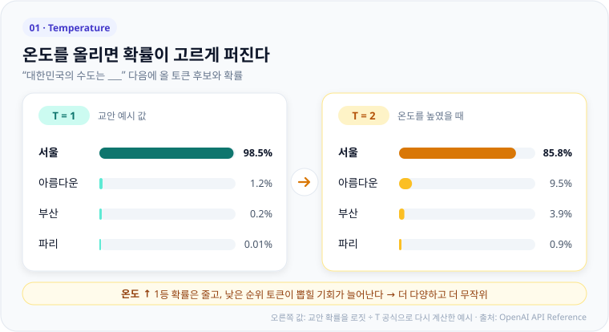
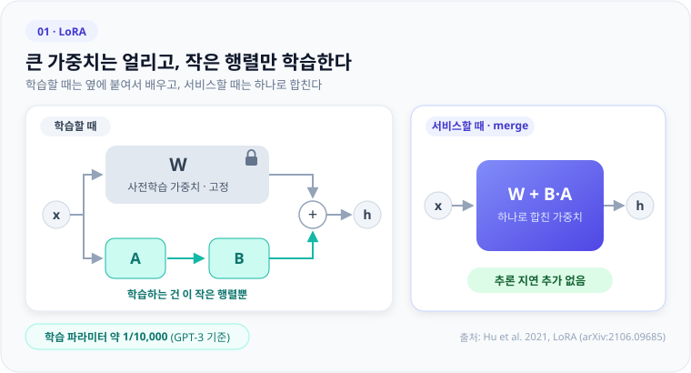
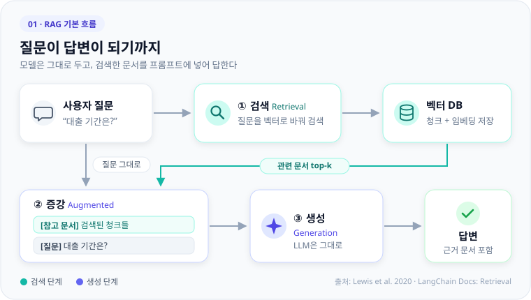

# 01. LLM의 한계와 RAG

> **지금 위치:** **[Part 1 기초: 01 · 02]** → Part 2 파이프라인(03 · 04 · 05) → Part 3 품질 개선(06 · 07 · 08) → Part 4 평가(09 · 10)
>
> [← 지도](00_지도.md) | [다음: 02 임베딩과 유사도 →](02_임베딩과_유사도.md)

> **검증 완료** (2026-11-19) — ✅ 9 · ⚠️ 4 · ❌ 0 · ❓ 1 · 기준: 공식 문서·원 논문 · [검증 보고서 보기](검증/01_02_검증보고서.md#01-llm의-한계와-rag)
> 본문의 ⚠️ / ❓ 표시는 "공식 문서는 이렇게 말한다"는 뜻입니다. 원래 노트 내용은 그대로 두었습니다.

## 핵심 질문

**LLM은 왜 모르는 것도 그럴듯하게 지어낼까? 그리고 RAG는 이 문제를 어떻게 푸나?**

## 한 줄 요약

LLM은 학습 시점까지의 지식만 가진 "다음 단어 확률 예측기"라서 모르는 걸 지어낸다(환각). RAG는 모델을 다시 학습시키지 않고, **질문과 관련된 문서를 검색해서 프롬프트에 넣어 주는 방식**으로 이 문제를 해결한다.

---

## 1. 출발점: LLM은 어떻게 동작하나

> 출처: 교안 [chapter02/1.md](../chapter02/1.md) (1장 2강)

| 개념 | 설명 | 비유 |
|---|---|---|
| **토큰(Token)** | LLM이 글을 읽고 쓰는 최소 단위. 단어 1개 = 토큰 1개가 아니다. 한국어는 조사·어미 때문에 더 잘게 쪼개진다. | 사과를 한 입 크기로 자르기 |
| **임베딩(Embedding)** | 토큰을 수백~수천 차원의 숫자 벡터로 바꾼 것. 뜻이 비슷하면 가까운 위치에 놓인다. | 도서관에서 비슷한 책끼리 가까운 서가에 꽂기 |
| **다음 토큰 예측** | 지금까지의 문맥을 보고 다음에 올 확률이 가장 높은 토큰을 하나씩 이어 붙인다. | 친구 말 "시원한 냉..." → "냉면" |
| **Temperature** | 낮으면 1등 토큰만 고르고(정확), 높으면 2~3등도 섞는다(창의). | 온도 조절 다이얼 |
| **컨텍스트 윈도우** | 한 번에 읽을 수 있는 최대 토큰 수. 넘치면 오래된 내용부터 잊는다. | 작업 책상 크기 |



- 토큰 수가 곧 **비용**이고 **입력 한도**다. 그래서 문서를 통째로 넣지 않고 필요한 부분만 넣어야 한다. (→ 03 청킹으로 이어짐)

> ⚠️ **검증 01-2 · 토큰 분할 방식** — 영어가 아닌 언어가 글자 대비 토큰이 더 많은 경우가 많다는 건 맞습니다. 하지만 GPT 계열 토크나이저(tiktoken)는 **BPE** 방식이라, 문법적인 형태소가 아니라 학습 데이터에서 자주 나온 글자 조합 단위로 나눕니다. 위 표의 `[나][는]…`는 이해용 예시입니다. 실제 분할은 [OpenAI Tokenizer](https://platform.openai.com/tokenizer)에서 직접 확인할 수 있습니다.
> 출처: [OpenAI Help: tokens](https://help.openai.com/en/articles/4936856-what-are-tokens-and-how-to-count-them), [OpenAI Cookbook: tiktoken](https://developers.openai.com/cookbook/examples/how_to_count_tokens_with_tiktoken)

> ❓ **검증 01-4 · Temperature 구간** — 공식 문서는 범위(0~2)와 "높으면 무작위, 낮으면 결정적"만 말합니다. "0~0.3은 **항상** 1등만" 같은 구간 구분은 교안의 활용 가이드입니다. 그리고 `temperature`와 `top_p`는 동시에 바꾸지 말라고 권장합니다.
> 출처: [OpenAI API Reference](https://developers.openai.com/api/reference/python/resources/chat/subresources/completions/methods/create)

> ⚠️ **검증 01-5 · 컨텍스트 윈도우를 넘으면** — 컨텍스트 윈도우는 한 요청에서 쓸 수 있는 최대 토큰 수이고, **입력 + 출력(+ 추론) 토큰을 모두 포함**합니다. 넘쳤을 때 "오래된 것부터 잊는" 동작은 앞부분을 잘라 내도록 설정된 경우의 이야기입니다. OpenAI Responses API는 기본 설정이면 **오류(400)** 를 내고, `truncation: "auto"`일 때만 대화 앞부분부터 지웁니다.
> 출처: [OpenAI Docs: Conversation state](https://developers.openai.com/api/docs/guides/conversation-state), [OpenAI API Reference: Responses](https://developers.openai.com/api/reference/python/resources/responses/methods/create)

## 2. 문제: LLM의 두 가지 한계

> 출처: [26-11-12.md](../26-11-12.md) §1

### 1) 지식 컷오프 (Knowledge Cutoff)
- LLM은 **학습된 시점까지의 지식으로 고정**되어 있다.
- 그 이후의 사건·정보는 알 수 없다.

### 2) 지식 부재로 인한 환각 (Hallucination)
- LLM은 "사실인지"를 확인하지 않고 **"문맥상 가장 그럴듯한 단어"** 를 고른다.
- 사내 규칙처럼 학습한 적 없는 도메인 지식은 비어 있으므로, 그 빈자리를 그럴듯한 거짓으로 채운다.
- 큰 모델일수록 새로 학습시키는 비용이 크다.

> ✅ **검증 01-6, 01-7** — LangChain 공식 문서도 LLM의 두 가지 핵심 한계로 **유한한 컨텍스트**와 **정적인 지식**(학습 데이터가 특정 시점에 고정)을 들고, 질의 시점에 외부 지식을 가져오는 것이 RAG의 기반이라고 설명합니다. ([LangChain Docs: Retrieval](https://docs.langchain.com/oss/python/langchain/retrieval))

## 3. 해결책 후보 ① 파인튜닝 (Fine-tuning)

> 출처: [26-11-12.md](../26-11-12.md) §5, [26-11-17.md](../26-11-17.md) "파인튜닝보다 rag를 많이 쓰는 이유"

- 모델 자체를 추가로 학습시켜 새 지식을 넣는 방법.
- **LoRA (Low-Rank Adaptation)**: 기존 파라미터는 그대로 두고, 작은 파라미터 행렬을 옆에 붙여(병렬) 그 값만 학습한다. 그래서 학습이 빠르다.


- **PEFT (Parameter-Efficient Fine-Tuning)**: `LLM Base + 작은 추가 파라미터(W2)` 구조로, 일부 파라미터만 효율적으로 학습하는 방식들의 총칭. LoRA는 PEFT의 한 종류다.
- 효과에 대해서는 찬반 논문이 있고 연구가 진행 중이다.

> ⚠️ **검증 01-9 · LoRA는 서비스할 때 병렬?** — 기존 가중치를 고정하고 작은 저랭크 행렬만 학습해서 학습 파라미터가 크게 줄고 빠르다는 건 맞습니다(GPT-3 기준 학습 파라미터 1만 배 감소). 다만 논문이 강조하는 장점은, 서비스할 때 작은 행렬을 원래 가중치에 **합칠(merge) 수 있어서 추론 지연이 추가되지 않는다**는 점입니다. 병렬 구조는 학습할 때의 모습입니다.
> 출처: [Hu et al. 2021, LoRA](https://arxiv.org/abs/2106.09685)

> ⚠️ **검증 01-11 · "파인튜닝 = 기존 파라미터 유지 + 새 파라미터 추가"** — 이건 **PEFT 방식**의 설명입니다. Hugging Face PEFT 문서는 PEFT를 "베이스 모델의 **모든 파라미터를 학습하는 것**"과 비교합니다. 즉 전체 파인튜닝(Full Fine-tuning)은 기존 파라미터를 직접 수정합니다. 노트의 "경우에 따라 기존 파라미터 자체를 변경하기도 한다"가 이쪽입니다.
> 출처: [Hugging Face PEFT Quicktour](https://huggingface.co/docs/peft/en/quicktour), [HF smol-course: LoRA and PEFT](https://huggingface.co/learn/smol-course/unit1/3a)

### 파인튜닝의 한계
- 다시 학습시켜야 해서 **돈·시간이 많이 든다**.
- 새 정보가 생길 때마다 **또 학습**해야 한다.
- 답의 **근거(출처)를 보여 주기 어렵다**.

## 4. 해결책 ② RAG (Retrieval-Augmented Generation, 검색 증강 생성)

> 출처: [26-11-12.md](../26-11-12.md) §2, [26-11-17.md](../26-11-17.md)

**모델은 그대로 두고, 검색한 문서를 프롬프트의 `{context}`에 넣어 준다.** 문서만 바꾸면 최신 정보가 반영된다.



| 단계 | 하는 일 |
|---|---|
| **R**etrieval (검색) | 질문과 가장 관련 있는 지식을 찾는다 |
| **A**ugmented (증강) | 찾은 지식을 프롬프트에 붙인다 |
| **G**eneration (생성) | LLM이 그 지식을 근거로 답한다 |

### 핵심 포인트: 검색이 제일 중요하다
- 질문과 맞지 않는 지식을 넣으면 **오히려 환각이 생긴다**.
  - ✅ 검증 01-13: 관련 없는 정보가 섞이면 LLM 정확도가 크게 떨어진다는 연구가 있다. 논문은 이를 "환각"보다 **"주의가 흐트러져 틀린다"** 로 표현한다. ([Shi et al. 2023](https://arxiv.org/abs/2302.00093))
- 그래서 RAG 공부의 대부분(03 ~ 08)이 **"어떻게 하면 더 잘 찾을까"** 에 관한 내용이다.
- 수업 표현: *"RAG는 검색 품질에 목숨을 걸어야 한다."* (26-11-18)

### RAG 전체 순서 (시험 단골)
```
문서 수집 → 문서 분할(청킹) → 임베딩 → (저장) → 검색 → 생성
```

## 5. 파인튜닝 vs RAG 비교

| 기준 | 파인튜닝 | RAG |
|---|---|---|
| 새 지식 반영 | 다시 학습 필요 | 문서만 교체 |
| 비용·시간 | 큼 | 상대적으로 작음 |
| 출처 제시 | 어려움 | 검색한 문서를 근거로 제시 가능 |
| 모델 변경 | 모델 파라미터가 바뀜 | 모델 그대로 |

> ✅ **검증 01-12** — RAG 원 논문은 출처(provenance) 제시와 세계 지식 갱신을 기존 모델의 미해결 문제로 들고, **검색 인덱스만 바꿔서 모델의 지식을 갱신**할 수 있음을 보였습니다. ([Lewis et al. 2020](https://arxiv.org/abs/2005.11401))
> ✅ **검증 01-8** — 검색 증강이 대화에서 환각을 줄인다는 연구도 있습니다. ([Shuster et al. 2021](https://arxiv.org/abs/2104.07567))

---

## 이 방식의 한계 → 다음 세션

RAG는 "질문과 **비슷한 뜻**의 문서를 찾는다"고 했다. 그런데 컴퓨터는 글자만 볼 수 있는데 **"뜻이 비슷하다"를 어떻게 계산할까?**
→ [02. 임베딩과 유사도](02_임베딩과_유사도.md)

---

## 스스로 점검

1. 지식 컷오프와 환각은 각각 무엇이고, 둘은 어떻게 연결되나?
2. 단순 LLM 호출과 비교했을 때 RAG의 가장 핵심적인 이점은?
3. 파인튜닝 대신 RAG를 많이 쓰는 이유 세 가지는?
4. RAG 파이프라인의 순서를 말해 보자.
5. 대화가 길어지면 AI가 초반 규칙을 잊는 이유는?

<details>
<summary>답 보기</summary>

1. 지식 컷오프는 학습 시점 이후의 지식이 없는 것이고, 환각은 모르는 부분을 그럴듯한 거짓으로 채우는 것이다. 모르는 지식(컷오프, 도메인 지식 부재)이 환각의 원인이 된다.
2. 외부 DB에서 최신·도메인 지식을 검색해 답변의 근거로 넣어 주므로 환각을 크게 줄일 수 있다.
3. 재학습 비용·시간이 크다 / 새 정보마다 다시 학습해야 한다 / 출처를 보여 주기 어렵다.
4. 문서 수집 → 분할(청킹) → 임베딩 → 검색 → 생성
5. 컨텍스트 윈도우를 넘어서, 앱이 오래된 대화 앞부분을 잘라 냈기 때문이다. (API를 직접 쓰면 기본 설정에서는 잘라 내지 않고 오류가 난다 — 검증 01-5)

</details>

## 원본 노트

- [26-11-12.md](../26-11-12.md) — §1 LLM의 한계, §2 RAG, §5 파인튜닝, 마지막 문제 2개
- [26-11-17.md](../26-11-17.md) — "파인튜닝보다 rag를 많이 쓰는 이유"
- [chapter02/1.md](../chapter02/1.md) — 교안 1장 2강 (토큰, 임베딩, 다음 토큰 예측, Temperature, 컨텍스트 윈도우)
