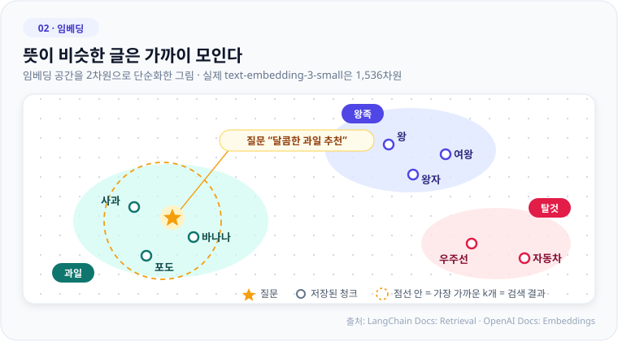
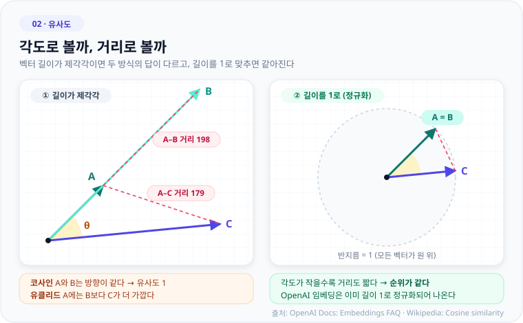
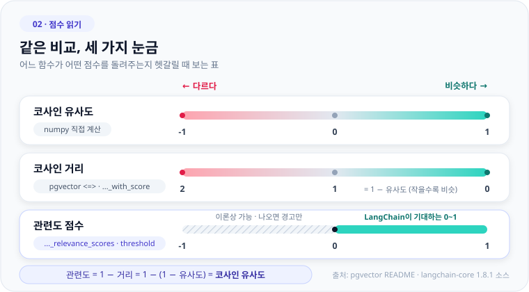

# 02. 임베딩과 유사도

> **지금 위치:** **[Part 1 기초: 01 · 02]** → Part 2 파이프라인(03 · 04 · 05) → Part 3 품질 개선(06 · 07 · 08) → Part 4 평가(09 · 10)
>
> [← 이전: 01 LLM의 한계와 RAG](01_LLM의_한계와_RAG.md) | [지도](00_지도.md) | [다음: 03 ETL과 청킹 →](03_ETL과_청킹.md)

> **검증 완료** (2026-11-19) — ✅ 8 · ⚠️ 4 · ❌ 0 · ❓ 0 · 기준: 공식 문서·설치된 라이브러리 소스(langchain-core 1.8.1, langchain-postgres 0.0.19) · [검증 보고서 보기](검증/01_02_검증보고서.md#02-임베딩과-유사도)
> 본문의 ⚠️ 표시는 "공식 문서는 이렇게 말한다"는 뜻입니다. 원래 노트 내용은 그대로 두었습니다.

## 핵심 질문

**"뜻이 비슷하다"를 컴퓨터는 어떻게 계산할까?**

## 한 줄 요약

글을 **임베딩 모델**로 숫자 벡터로 바꾸면, 뜻이 비슷한 글끼리 가까이 모인다. 그 "가까움"을 **코사인 유사도 / 유클리드 거리 / 내적**으로 계산한다.

---

## 왜 필요한가 (01의 한계)

RAG는 질문과 관련된 문서를 찾아야 한다. 하지만 DB는 텍스트 그 자체로는 "뜻이 비슷한지"를 비교할 수 없다. 그래서 **비교 가능한 숫자(벡터)** 로 바꿔야 한다.

## 1. 임베딩 모델 (Embedding Model)

> 출처: [26-11-12.md](../26-11-12.md) §3, [26-11-17.md](../26-11-17.md)

```
질문 "도서관 대출 기간?" ──▶ 임베딩 모델 ──▶ [0.02, 0.01, -0.02, ...] (1,536개 숫자 등)
```

- 임베딩 모델은 학습으로 만들어진 모델이다. 실습에서는 `OpenAIEmbeddings(model="text-embedding-3-small")`를 썼다.
- 뜻이 비슷한 벡터끼리 **군집(cluster)** 을 이룬다.



- 벡터 DB에는 **지식(청크) + 그 임베딩 벡터**가 함께 저장된다.
- 검색 품질이 임베딩 품질에 달려 있으므로, **임베딩 모델 선택이 중요**하다.

### 중요: 저장과 검색에 같은 임베딩 모델을 써야 한다
- 임베딩 모델은 글을 **자기만의 좌표 지도** 위의 점으로 바꾼다. 모델마다 지도가 다르다.
- 저장할 때 A 모델, 검색할 때 B 모델을 쓰면 서로 다른 지도의 좌표끼리 거리를 재는 셈이라 엉뚱한 문서가 나온다.
- 그래서 `PGVector(embeddings=embedding_model, ...)`처럼 저장소에 모델을 한 번 넣어 두면, 저장(`add_documents`)과 검색(`similarity_search`, retriever)에서 **자동으로 같은 모델**을 쓴다.
  - ✅ 검증 02-3: 설치된 `langchain_postgres` 0.0.19 소스에서 저장은 `embed_documents`, 검색은 `embed_query`를 **생성자에 넣은 같은 객체**로 호출한다.
- ✅ 검증 02-2: `text-embedding-3-small`의 기본 길이는 **1,536**이다(3-large는 3,072). `dimensions` 파라미터로 줄일 수 있다. ([OpenAI Docs: Embeddings](https://developers.openai.com/api/docs/guides/embeddings))

## 2. 유사도 계산 세 가지

| 방법 | 계산 | 값의 의미 | 특징 |
|---|---|---|---|
| **유클리드 거리** | 두 점 사이 직선 거리 (피타고라스) | **작을수록** 비슷 | 거리 개념 |
| **코사인 유사도** | 두 벡터 사이 각도의 코사인 | -1 ~ 1, **1에 가까울수록** 비슷 | 실무에서 가장 많이 씀 |
| **내적 (Dot Product)** | 원소끼리 곱해서 더하기 | 클수록 비슷 | 방향 + 크기 모두 반영. 정규화된 벡터면 코사인과 거의 같음 |



코사인 유사도 값 읽는 법:
- `1` 에 가까움 → 같은 의미
- `0` 에 가까움 → 무관
- `-1` 에 가까움 → 반대 의미

> ⚠️ **검증 02-5 · "-1 = 반대 의미"** — 수학적으로 -1은 "반대 **방향**"입니다. 실제 단어 임베딩에서는 반의어(뜨겁다/차갑다)가 비슷한 문맥에 쓰이기 때문에 **오히려 유사도가 중간~높게** 나온다는 연구가 있습니다. "반대 의미 = -1"로 외우면 안 됩니다.
> 출처: [Wikipedia: Cosine similarity](https://en.wikipedia.org/wiki/Cosine_similarity), [IWCS 2023: The Effects of Antonymy and Polysemy](https://aclanthology.org/2023.iwcs-1.17.pdf)

> ⚠️ **검증 02-6 · 코사인을 많이 쓰는 이유** — OpenAI가 코사인 유사도를 **권장하는 것은 맞습니다**. 하지만 "반대 의미도 정보라서"라는 이유는 문서에서 확인되지 않습니다. 확인되는 이유는 코사인이 **벡터 크기와 무관하게 각도만** 본다는 점입니다(Claude의 기존 보충 설명, ✅). OpenAI 문서는 "거리 함수 선택은 보통 큰 차이가 없다"고도 말합니다.
> 출처: [OpenAI Docs: Embeddings FAQ](https://developers.openai.com/api/docs/guides/embeddings), [Wikipedia: Cosine similarity](https://en.wikipedia.org/wiki/Cosine_similarity)

> ⚠️ **검증 02-7 · 내적 ≈ 코사인?** — 길이가 1로 정규화되어 있으면 내적과 코사인은 "거의"가 아니라 **정확히 같습니다**. 그리고 OpenAI 임베딩은 **이미 길이 1로 정규화**되어 나옵니다. 그래서:
> - 내적으로 계산해도 코사인과 같은 값이 나오고, 조금 더 빠릅니다.
> - **코사인 유사도와 유클리드 거리도 같은 순위**를 냅니다. (검증 02-8에서 새로 알게 된 점)
>
> 출처: [OpenAI Docs: Embeddings FAQ](https://developers.openai.com/api/docs/guides/embeddings)

## 3. 코드로 보기 — numpy로 직접 계산

> 출처: `chapter01/src/similrary.ipynb`, [26-11-12.md](../26-11-12.md) 하단 numpy 정리

```python
import numpy as np

def cosine_similarity(v1, v2):
    # 내적 ÷ (길이 × 길이) → 방향만 비교
    return np.dot(v1, v2) / (np.linalg.norm(v1) * np.linalg.norm(v2))

def euclidean_distance(v1, v2):
    # 두 점 사이 직선 거리
    return np.linalg.norm(np.array(v1) - np.array(v2))

from langchain_openai import OpenAIEmbeddings
embedding_model = OpenAIEmbeddings(model="text-embedding-3-small")

v_apple_ko = embedding_model.embed_query("사과")
v_apple_en = embedding_model.embed_query("Apple")
cosine_similarity(v_apple_ko, v_apple_en)   # 언어가 달라도 뜻이 같으면 높게 나온다
```

| numpy 함수 | 하는 일 | 쓰이는 곳 |
|---|---|---|
| `np.dot(v1, v2)` | 내적 (곱해서 더하기) | 코사인 유사도의 분자 |
| `np.linalg.norm(v)` | 벡터 길이(L2 norm) | 코사인 유사도의 분모, 유클리드 거리 |
| `np.array(v1) - np.array(v2)` | 원소별 뺄셈 | 유클리드 거리 |

왜 numpy가 필요한가: 파이썬 리스트는 `[1,2,3] - [4,5,6]` 같은 벡터 연산을 못 한다. 임베딩은 수백~수천 차원이라 반복문으로 하면 느리고 코드가 지저분해진다.

## 4. 거리(distance) vs 관련도(relevance score)

> 출처: [26-11-17.md](../26-11-17.md) "왜 1 −를 하나?", `chapter03/03_01.ipynb`

LangChain/pgvector에서는 **코사인 유사도 대신 코사인 "거리"** 가 나올 때가 있어서 헷갈린다.

```
코사인 거리 = 1 − 코사인 유사도
관련도 점수 = 1 − 코사인 거리   (0~1, 클수록 비슷)
```



| 값 | 같은 방향 | 직각 | 반대 방향 |
|---|---|---|---|
| 코사인 유사도 | 1 | 0 | -1 |
| 코사인 거리 | 0 | 1 | 2 |

- 왜 "1 −"를 하나? 거리는 "같은 자리면 0"이어야 하니까. 유사도 만점(1)에서 얼마나 모자라는지가 거리다. (물컵 1컵 가득 = 1, 더 필요한 물 = 거리)
- 실습 예: 거리 `0.4497` ↔ 관련도 `0.5503` (더하면 1)
- 유클리드 거리는 처음부터 거리라서 1을 뺄 필요가 없다. 관련도로 바꿀 때 LangChain은 `1 − 거리/√2` 를 쓴다.

> ✅ **검증 02-9, 02-11**
> - pgvector의 `<=>`는 코사인 **거리**이고, 코사인 유사도는 `1 - (embedding <=> ...)`로 구한다. ([pgvector README](https://github.com/pgvector/pgvector/blob/master/README.md))
> - 설치된 langchain-core 1.8.1의 `_euclidean_relevance_score_fn`은 `1.0 - distance / math.sqrt(2)`를 반환한다. `√2`로 나누는 이유(소스 주석): **정규화된 임베딩**이면 유클리드 거리가 0(가장 비슷) ~ √2(가장 다름) 사이라서, 이를 0~1로 바꾸려는 것이다.
>
> ⚠️ **검증 02-10 · 관련도는 항상 0~1?** — 공식 `관련도 = 1 − 코사인 거리`는 맞습니다(`_cosine_relevance_score_fn`, PGVector 기본 거리 전략은 COSINE). 그런데 이 값을 풀면 `1 − (1 − 유사도) = 코사인 유사도`, 즉 **관련도 점수는 코사인 유사도와 같은 값**입니다. 그래서 이론상 음수도 나올 수 있습니다. LangChain은 0~1을 기대하고, 벗어나면 `Relevance scores must be between 0 and 1` **경고만** 띄웁니다. (설치된 `langchain_core/vectorstores/base.py` 536행)

---

## 이 방식의 한계 → 다음 세션

이제 글을 벡터로 바꿔 비교할 수 있다. 그런데 **수십 페이지 문서를 통째로 하나의 벡터로 만들면** 어떻게 될까? 여러 주제가 섞여서 의미가 흐려지고, LLM에 넣기에도 너무 길다.
→ [03. ETL과 청킹](03_ETL과_청킹.md)

---

## 스스로 점검

1. DB에서 질문 텍스트를 그대로 검색할 수 없는 이유는?
2. 코사인 유사도 0.95, 0.02, -0.8은 각각 무슨 뜻인가?
3. 저장할 때와 검색할 때 다른 임베딩 모델을 쓰면 어떻게 되나?
4. `similarity_search_with_score`에서 점수가 0.2인 문서와 0.6인 문서 중 어느 쪽이 더 비슷한가? (코사인 거리 기준)
5. 내적이 코사인 유사도와 거의 같아지는 조건은?

<details>
<summary>답 보기</summary>

1. 뜻이 비슷한지를 비교하려면 계산 가능한 숫자(벡터)가 필요하기 때문이다.
2. 방향이 거의 같음(뜻이 매우 비슷) / 거의 직각(관련 적음) / 방향이 반대에 가까움. 단, 실제 임베딩에서 반의어는 -1이 아니라 오히려 높게 나오기도 한다(검증 02-5).
3. 서로 다른 좌표 지도의 점끼리 거리를 재는 셈이라 엉뚱한 문서가 검색된다.
4. 0.2. 거리는 작을수록 비슷하다.
5. 벡터가 정규화되어 있을 때(길이가 1일 때). 이때는 정확히 같다. OpenAI 임베딩은 이미 정규화되어 나온다.

</details>

## 원본 노트

- [26-11-12.md](../26-11-12.md) — §3 임베딩 모델, 유사도, numpy 정리
- [26-11-17.md](../26-11-17.md) — 관련도 = 1 − 코사인 거리, 임베딩 모델 좌표 지도
- `chapter01/src/similrary.ipynb` — 코사인·유클리드 직접 구현
- `chapter03/03_01.ipynb` — 거리 vs 관련도 점수
