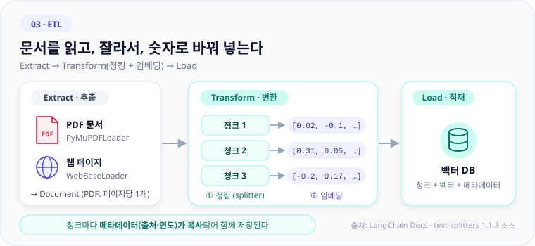
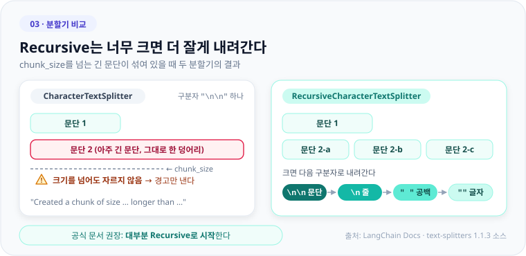

# 03. ETL과 청킹

> **지금 위치:** Part 1 기초(01 · 02) → **[Part 2 파이프라인: 03 · 04 · 05]** → Part 3 품질 개선(06 · 07 · 08) → Part 4 평가(09 · 10)
>
> [← 이전: 02 임베딩과 유사도](02_임베딩과_유사도.md) | [지도](00_지도.md) | [다음: 04 벡터 저장소 →](04_벡터저장소_PGVector.md)

> **검증 완료** (2026-11-19) — ✅ 6 · ⚠️ 2 · ❌ 0 · ❓ 3 · 기준: 설치된 소스(langchain-text-splitters 1.1.3, langchain-classic 1.0.8)·공식 문서 · [검증 보고서 보기](검증/03_05_검증보고서.md#03-etl과-청킹)
> 본문의 ⚠️ / ❓ 표시는 "공식 문서는 이렇게 말한다"는 뜻입니다. 원래 노트 내용은 그대로 두었습니다.

## 핵심 질문

**긴 문서를 어떻게 가져와서, 어떻게 잘라서, 어떻게 넣어야 할까?**

## 한 줄 요약

문서를 지식 저장소에 넣는 과정이 **ETL(추출 → 변환 → 적재)** 이고, 변환 단계의 핵심은 문서를 적당한 크기로 자르는 **청킹**이다. 청크 크기와 겹침(overlap)에는 정답이 없고, 평가하며 조정한다.

---

## 왜 필요한가 (02의 한계)

문서를 통째로 배경지식으로 넣으면:
1. **컨텍스트 윈도우 한계** — 모든 지식을 한 번에 넣을 수 없다.
2. **의미 희석** — 너무 길면 관련 없는 내용이 섞여 의미가 흐려지고 답변 품질이 떨어진다.

그래서 단락 단위로 쪼개서(청킹) 필요한 조각만 넣는다. 이 조각을 **청크(chunk)** 라고 부른다.

## 1. ETL (Extract, Transform, Load)

> 출처: [26-11-12.md](../26-11-12.md) §4

| 단계 | 하는 일 | 실습에서 쓴 도구 |
|---|---|---|
| **E**xtract (추출) | text, PDF, HTML 등에서 데이터를 가져온다 | `PyMuPDFLoader`, `WebBaseLoader` |
| **T**ransform (변환) | 저장소에 맞게 전처리한다. **청킹 + 임베딩**이 여기서 일어난다 | `RecursiveCharacterTextSplitter`, `OpenAIEmbeddings` |
| **L**oad (적재) | 변환한 데이터를 DB에 넣는다 | `InMemoryVectorStore`, `PGVector` (→ 04) |



> ✅ **검증 03-1, 03-2** — LangChain 공식 문서의 파이프라인도 "문서 로더 → 청크로 분할 → 임베딩 → 벡터 저장소" 순서입니다. 분할하는 이유도 "청크를 **개별로 검색**할 수 있고 모델 **컨텍스트 한도**에 맞추기 위해서"라고 설명합니다. ([LangChain Docs: Retrieval](https://docs.langchain.com/oss/python/langchain/retrieval), [Text splitters](https://docs.langchain.com/oss/python/integrations/splitters))

```python
# Extract: PDF 불러오기 (chapter02/02_01.ipynb)
from langchain_community.document_loaders import PyMuPDFLoader
pdf_documents = PyMuPDFLoader(file_path="academic_rules_2026.pdf").load()   # 페이지마다 Document 1개

# 웹 페이지는 WebBaseLoader(url).load()
```

## 2. 청킹 (Chunking)

### 두 가지 분할기

> 출처: `chapter02/01_01.ipynb`

| 분할기 | 자르는 방식 |
|---|---|
| `CharacterTextSplitter` | 구분자 **하나**(기본 `"\n\n"`, 문단)로만 자른다 |
| `RecursiveCharacterTextSplitter` | 구분자 목록을 **차례로** 시도한다. 기본값 `["\n\n", "\n", " ", ""]` → 문단 → 줄 → 공백 → 글자. 크기에 맞을 때까지 점점 잘게 자른다 |



> ✅ **검증 03-3** — `CharacterTextSplitter`는 구분자로만 자르기 때문에, 한 문단이 `chunk_size`보다 커도 **더 자르지 않고** "Created a chunk of size … longer than" 경고만 냅니다. (`langchain_text_splitters/character.py` 18행, `base.py` 183행)

> ⚠️ **검증 03-4 · 마지막 구분자 `""`** — 실습 `01_01.ipynb` 주석에는 "문단 → 다음 줄 → 공백 → **마침표**"라고 적혀 있지만, 마지막 `""`는 **글자 단위**로 자르라는 뜻입니다. 공식 문서도 "문단을 유지하려 하고, 크면 다음 단위로, 필요하면 단어 단위까지 내려간다"고 설명합니다. 그리고 공식 문서는 대부분의 경우 이 분할기로 시작하라고 권장합니다.
> 출처: `langchain_text_splitters/character.py` 107행, [LangChain Docs: Text splitters](https://docs.langchain.com/oss/python/integrations/splitters)

```python
from langchain_text_splitters import RecursiveCharacterTextSplitter

splitter = RecursiveCharacterTextSplitter(
    chunk_size=300,       # 청크 최대 글자 수
    chunk_overlap=100,    # 앞 청크와 겹치는 글자 수
    separators=["##", "###"],   # 마크다운 제목 기준으로 자르기 (직접 지정 가능)
)
chunks = splitter.split_text(raw_text)          # 문자열 → 문자열 리스트
docs   = splitter.split_documents(pdf_documents)  # Document → Document 리스트 (메타데이터 유지)
```

### 청킹의 약점과 보완: Overlap (겹침)
- 청크로 나누면 핵심만 넣을 수 있다는 장점이 있다.
- 하지만 **연결된 두 단락이 경계에서 잘리면** 맥락이 끊긴다.
- 그래서 청크를 **겹치게(overlap)** 나눠 앞뒤 맥락을 이어 준다.


> ✅ **검증 03-5** — LangChain 분할기의 기본값은 `chunk_size=4000`, `chunk_overlap=200`이고, 길이는 `len`, 즉 **글자 수**로 잽니다. 토큰 수로 자르고 싶으면 `from_tiktoken_encoder(...)`를 씁니다. (`langchain_text_splitters/base.py` 64–66행)

### 청크 크기, 정답은 없다
- 보통 **200 ~ 1,000자**. 데이터 성격에 따라 다르다.
  - 맥락이 길게 이어지는 글 → 크게
  - 단락이 짧게 끊기는 글 → 작게
- 한 번에 찾는 게 아니라 **평가를 반복하며 조정**한다 (→ 09, 10).

| 증상 | 조정 방향 |
|---|---|
| 검색 결과 유사도가 낮다 (노이즈가 많이 섞임) | 청크 크기 **줄이기** |
| 답변이 엉뚱한 방향으로 나온다 (맥락 부족) | 청크 크기 **늘리기** |
| overlap에도 노이즈가 낄 수 있다 | 시행착오로 조절 |

- **표(table)** 는 텍스트와 달리 손이 많이 간다. 특히 PDF에서는 구조가 쉽게 깨지므로 **마크다운 표로 변환**해서 넣는 게 낫다.

> ❓ **검증 03-6 ~ 03-8 · 경험칙** — "보통 200~1,000자", "유사도가 낮으면 줄이고 엉뚱하면 늘린다", "표는 마크다운으로"는 공식 문서에서 근거를 찾지 못했습니다. 틀렸다는 뜻이 아니라 **수업에서 배운 경험칙**이라는 뜻입니다. 공식 문서는 "기본값으로 시작하고, 필요할 때만 조정하라"고 하며, 마크다운 제목·HTML 태그처럼 **문서 구조를 따라 자르는 분할기**를 따로 제공합니다. 정답은 09·10의 평가로 확인합니다.
> 출처: [LangChain Docs: Text splitters](https://docs.langchain.com/oss/python/integrations/splitters)

## 3. 메타데이터 붙이기

> 출처: `chapter02/01_06.ipynb`

```python
from langchain_core.documents import Document

doc = Document(
    page_content="제1조 원칙: ... 제2조 이용 시간: 평일 9시부터 ...",
    metadata={"source": "cs_lab_policy.pdf", "department": "컴퓨터공학과", "version": "v1.2"},
)
docs = splitter.split_documents([doc])   # 잘린 청크마다 같은 metadata가 복사된다
```

- 출처, 연도, 학과 같은 **메타데이터**는 나중에 검색을 걸러낼 때 쓴다 (→ 04 메타데이터 필터).
  - ✅ 검증 03-9: 청크마다 메타데이터를 `deepcopy`로 복사한다. `add_start_index=True`를 주면 원문에서의 시작 위치(`start_index`)도 넣어 준다. (`base.py` 130–142행)
- ✅ 검증 03-10: `PyMuPDFLoader`는 기본 `mode="page"`라서 **페이지마다 Document 1개**를 만든다. `mode="single"`이면 문서 전체가 1개다. (`document_loaders/pdf.py` 777행)
- 답변에 **출처를 표시**할 때도 쓴다.

## 4. 임베딩 캐시 — 같은 글을 두 번 돈 내고 임베딩하지 않기

> 출처: `chapter02/02_04_2.ipynb`

```python
from langchain_classic.embeddings import CacheBackedEmbeddings
from langchain_classic.storage import LocalFileStore

store = LocalFileStore("./cache/")
cached_embedder = CacheBackedEmbeddings.from_bytes_store(
    underlying_embeddings=embedding_model,   # 실제로 임베딩할 모델
    document_embedding_cache=store,          # 결과를 저장할 곳
    namespace="library_rules",               # 모델·용도별로 캐시 구분
)

cached_embedder.embed_documents(chunks)  # 1회차: API 호출 → 캐시 파일 저장 (느림)
cached_embedder.embed_documents(chunks)  # 2회차: 캐시에서 읽음 (빠름, 비용 0)
```

- 임베딩은 API 호출이라 **돈과 시간**이 든다. 같은 청크를 다시 임베딩할 때 캐시를 쓰면 아낄 수 있다.
- `chapter02/cache/` 폴더에 생긴 파일이 이 캐시다.

> ⚠️ **검증 03-11 · 질문도 캐시될까?** — 문서 임베딩 캐시와 `namespace`(같은 글을 다른 모델로 임베딩한 결과와 섞이지 않게 구분)는 맞습니다. 하지만 `embed_query`, 즉 **검색할 때 질문 임베딩은 기본적으로 캐시하지 않습니다.** 질문까지 캐시하려면 `from_bytes_store(..., query_embedding_cache=True)`를 줘야 합니다.
> 출처: `langchain_classic/embeddings/cache.py` 241–255행, 293–309행

## 5. 전체 흐름 한 번에 (chapter01/src/02.ipynb)

```python
# 청킹
split_docs = RecursiveCharacterTextSplitter(chunk_size=90, chunk_overlap=40).create_documents([raw_text])
# 임베딩 + 적재 (메모리)
vector_store = InMemoryVectorStore.from_documents(documents=split_docs, embedding=embedding_model)
# 검색
retriever = vector_store.as_retriever(search_kwargs={"k": 2})
retriever.invoke("직전 학기 평점이 4.1이에요. 이번 학기에 최대 몇 학점까지 신청할 수 있나요?")
```

- 내 실습 메모: 같은 글을 `RecursiveCharacterTextSplitter`로 자르면 4개, `CharacterTextSplitter`로 바꾸면 5개가 나왔다. 줄바꿈 처리 방식이 달라서다.

---

## 이 방식의 한계 → 다음 세션

지금까지 `InMemoryVectorStore`에 넣었다. 이건 **메모리에만 있어서 프로그램을 끄면 사라지고**, 문서가 많아지면 전부 하나하나 비교해야 해서 느리다. 실제 서비스에서는?
→ [04. 벡터 저장소(PGVector)](04_벡터저장소_PGVector.md)

---

## 스스로 점검

1. 문서를 통째로 넣으면 생기는 문제 두 가지는?
2. ETL의 T 단계에서 일어나는 두 가지 작업은?
3. `CharacterTextSplitter`와 `RecursiveCharacterTextSplitter`의 차이는?
4. overlap은 왜 필요한가? 너무 크면?
5. 답변이 엉뚱한 방향으로 나올 때 청크 크기를 어떻게 바꿔 볼까?
6. PDF 안의 표는 어떻게 처리하는 게 좋을까?

<details>
<summary>답 보기</summary>

1. 컨텍스트 윈도우 한계, 의미 희석
2. 청킹, 임베딩
3. Character는 구분자 하나로만 자르고(크면 경고만 내고 그대로 둠), Recursive는 문단 → 줄 → 공백 → 글자 순서로 점점 잘게 자른다.
4. 경계에서 잘린 맥락을 이어 주기 위해서다. 너무 크면 중복 내용이 노이즈가 된다.
5. 늘려 본다 (맥락 부족일 가능성). 단, 공식 규칙이 아니라 경험칙이므로 평가(09·10)로 확인한다 — 검증 03-7.
6. 마크다운 표 형식으로 변환해서 넣는다. (수업 경험칙, 공식 근거는 못 찾음 — 검증 03-8)

</details>

## 원본 노트

- [26-11-12.md](../26-11-12.md) — §4 청크와 ETL
- `chapter01/src/02.ipynb` — ETL 전체 흐름
- `chapter02/01_01.ipynb` — 두 분할기 비교, separators
- `chapter02/01_06.ipynb` — 메타데이터
- `chapter02/02_01.ipynb` — PDF, 웹 로더
- `chapter02/02_04.ipynb`, `02_04_2.ipynb` — 임베딩, 임베딩 캐시
