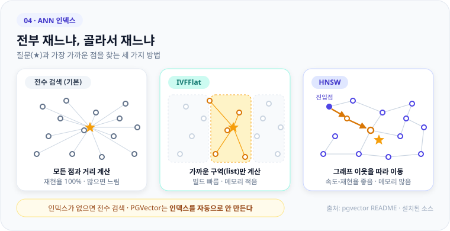
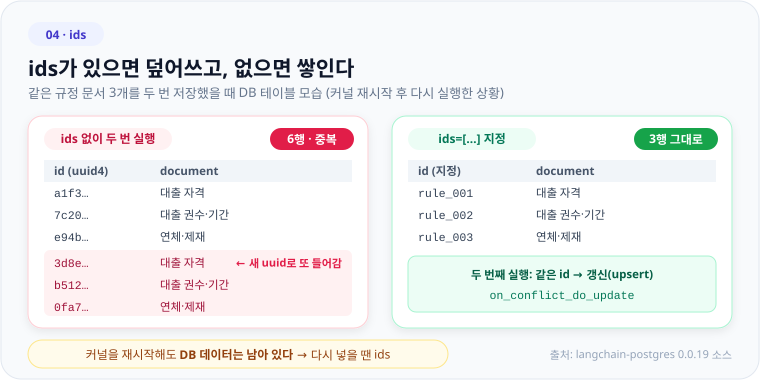

# 04. 벡터 저장소 (PGVector)

> **지금 위치:** Part 1 기초(01 · 02) → **[Part 2 파이프라인: 03 · 04 · 05]** → Part 3 품질 개선(06 · 07 · 08) → Part 4 평가(09 · 10)
>
> [← 이전: 03 ETL과 청킹](03_ETL과_청킹.md) | [지도](00_지도.md) | [다음: 05 리트리버와 RAG 체인 →](05_리트리버와_RAG체인.md)

> **검증 완료** (2026-11-19) — ✅ 11 · ⚠️ 1 · ❌ 0 · ❓ 0 · 기준: 설치된 소스(langchain-postgres 0.0.19, langchain-core 1.8.1)·pgvector README·PostgreSQL 문서 · [검증 보고서 보기](검증/03_05_검증보고서.md#04-벡터-저장소-pgvector)
> 본문의 ⚠️ 표시는 "공식 문서는 이렇게 말한다"는 뜻입니다. 원래 노트 내용은 그대로 두었습니다.

## 핵심 질문

**청크와 벡터를 껐다 켜도 남게 저장하고, 문서가 많아도 빠르게 찾으려면?**

## 한 줄 요약

PostgreSQL에 **pgvector 확장**을 깔면 벡터를 저장하고 거리 계산을 할 수 있고, LangChain의 **PGVector 클래스**가 임베딩·SQL·Document 변환을 대신 해 준다. 많은 데이터는 **ANN 인덱스**로 빠르게 찾고, **메타데이터 필터**로 걸러 낸다.

---

## 왜 필요한가 (03의 한계)

| 구분 | InMemoryVectorStore | PGVector |
|---|---|---|
| 저장 위치 | 컴퓨터 메모리 | 데이터베이스(디스크) |
| 프로그램 종료 후 | **사라짐** | 남아 있음 |
| 데이터 양 | 적음 | 많음 |
| 검색 방식 | 전수 조사 | 기본은 전수 조사, **인덱스를 만들면** ANN (검증 04-4) |

실제 서비스는 청크와 벡터를 계속 보관하고 빠르게 찾아야 하므로 DB가 필요하다. 그리고 임베딩은 API 비용이 들어서 매번 다시 만들 수도 없다.

- ✅ 검증 04-1: `InMemoryVectorStore`는 저장된 **모든** 벡터와 코사인 유사도를 한꺼번에 계산한다(인덱스 없음). (`langchain_core/vectorstores/in_memory.py` 298–314행)

> ⚠️ **검증 04-4 · PGVector면 자동으로 ANN?** — 아닙니다. pgvector는 인덱스가 없으면 **정확한 전수 검색**(완벽한 재현율)을 하고, **인덱스를 추가해야** ANN이 됩니다. 설치된 LangChain `PGVector` 0.0.19 소스에는 HNSW·IVFFlat 인덱스를 만드는 코드가 없습니다. 그래서 실습처럼 PGVector만 쓰면 지금은 **전수 검색**이고, ANN을 쓰려면 DB에서 직접 인덱스를 만들어야 합니다.
> ```sql
> CREATE INDEX ON langchain_pg_embedding USING hnsw (embedding vector_cosine_ops);
> ```
> 출처: [pgvector README](https://github.com/pgvector/pgvector/blob/master/README.md), `langchain_postgres/vectorstores.py`(hnsw·ivfflat 없음)
> 테이블 이름 `langchain_pg_embedding`과 컬럼 `embedding`은 설치된 소스의 기본값입니다(`vectorstores.py` 201·782행). 컬렉션 정보는 `langchain_pg_collection` 테이블에 따로 있습니다(114행).

## 1. pgvector vs PGVector (이름이 같아서 헷갈림)

> 출처: [26-11-17.md](../26-11-17.md)

| | **pgvector** (소문자) | **PGVector** (대문자) |
|---|---|---|
| 정체 | PostgreSQL **확장 기능** | LangChain **파이썬 클래스** |
| 하는 일 | ① `vector` 타입으로 벡터 저장 ② 거리 연산자로 유사도 계산 ③ ANN 인덱스 | 임베딩 모델 호출, SQL 만들기, 결과를 `Document`로 바꾸기 (홀 매니저 역할) |
| 관계 | 주방 | 주문 받고 통역하는 직원 |

pgvector 거리 연산자:

| 연산자 | 거리 |
|---|---|
| `<=>` | 코사인 거리 |
| `<->` | 유클리드 거리 |
| `<#>` | 내적 (음수) |

- ✅ 검증 04-2, 04-3: 연산자 세 개는 pgvector README와 같다. 그 밖에 `<+>` L1, `<~>` 해밍, `<%>` 자카드(이진 벡터)도 있다. PGVector 클래스는 `CREATE EXTENSION IF NOT EXISTS vector`를 실행하는 메서드를 갖고 있다. (`vectorstores.py` 240·503행)

- PGVector 클래스는 pgvector가 설치된 DB가 있어야 동작한다.
- pgvector는 `ORDER BY 거리 LIMIT k` 처럼 **거리가 작은 순**으로 줄 세운다.

## 2. ANN (Approximate Nearest Neighbor, 근사 최근접 이웃)

> 출처: [26-11-17.md](../26-11-17.md)

**"정답에 거의 가까운 것을, 전부 뒤지지 않고 아주 빨리 찾는 방법"**

| 방식 | 계산량 | 정확도 |
|---|---|---|
| 전수 조사 (Brute-force, 정확한 KNN) | 문서 100만 개 → 100만 번 계산. 문서가 늘수록 **선형으로 느려짐** | 100% |
| ANN | 가까울 만한 구역만 계산 | 가끔 진짜 1등을 놓침 |

- **트레이드오프**: 속도가 크게 빨라지는 대신 정확도를 조금 양보한다. 그래서 "근사"다.
- RAG에서는 1등 한두 개를 놓치는 것보다 **빠른 응답**이 중요한 경우가 많아서 많이 쓴다.

pgvector가 지원하는 ANN 인덱스:

| 인덱스 | 방식 | 비유 |
|---|---|---|
| **IVFFlat** | 벡터를 미리 군집(구역)으로 나눠 두고 가까운 구역만 찾는다 | 동네별로 나눠 놓고 우리 동네만 뒤지기 |
| **HNSW** | 벡터를 그래프로 연결해서 가까운 이웃을 따라가며 찾는다 | 친구의 친구를 따라가며 찾기 |



> ✅ **검증 04-5 ~ 04-7** — pgvector README 기준으로 노트 설명이 맞습니다. 비교할 때 알아 둘 점:
>
> | | IVFFlat | HNSW |
> |---|---|---|
> | 속도-재현율 | 낮음 | **더 좋음** |
> | 인덱스 만드는 시간 | **빠름** | 느림 |
> | 메모리 | **적게** 씀 | 많이 씀 |
> | 언제 만드나 | 데이터가 어느 정도 쌓인 **뒤에** (리스트를 학습함) | 빈 테이블에도 가능 (학습 단계 없음) |
>
> 인덱스를 쓰면 같은 쿼리도 결과가 조금 달라질 수 있습니다(근사 검색이므로).
> 출처: [pgvector README](https://github.com/pgvector/pgvector/blob/master/README.md)

## 3. 코드로 보기 — 저장과 검색

> 출처: `chapter02/02_05.ipynb`

```python
from langchain_postgres.vectorstores import PGVector

vector_store = PGVector(
    embeddings=embedding_model,          # 저장·검색에 같은 모델이 자동으로 쓰인다 (→ 02)
    connection=os.getenv("DATABASE_URL"),
    collection_name="library_rules",     # 문서 묶음 이름 (테이블 안의 그룹)
    use_jsonb=True,                      # 메타데이터를 JSONB로 저장
)

# 저장: ids를 주면 같은 id는 덮어쓴다
vector_store.add_texts(texts=library_rule_chunks, ids=["rule_chunk_001", "rule_chunk_002", "rule_chunk_003"])

# 검색
vector_store.similarity_search(query="특수 도서는 며칠 대출할 수 있나요?", k=1)            # Top-K
vector_store.similarity_search_with_score(query=..., k=3)   # 점수(코사인 거리)도 같이
```

### 저장 방법 두 가지

> 출처: `chapter05/05_02.ipynb` 마크다운 셀

| 방법 | 하는 일 |
|---|---|
| `PGVector(...)` 만든 뒤 `add_documents(docs)` | ① 연결 + 모델 기억 ② `add_documents` 안에서 벡터화 + DB 저장 |
| `PGVector.from_documents(documents=..., embedding=..., ...)` | 연결 + 벡터화 + 저장을 **한 번에** |

### 주의: 다시 실행하면 중복으로 쌓인다
- 커널을 재시작하면 파이썬 변수(메모리)는 사라지지만 **DB 데이터는 남는다**.
- 그래서 `from_documents`를 **ids 없이** 다시 실행하면 같은 문서가 **또 쌓인다**. `ids=[...]` 를 주면 덮어쓴다.



> ✅ **검증 04-8, 04-9** — ids가 없으면 매번 새 `uuid4()`를 만들어서 같은 내용도 새 행이 되고, ids를 주면 `on_conflict_do_update`(이미 있으면 갱신)로 덮어씁니다. (`langchain_postgres/vectorstores.py` 767–769·791행)

## 4. JSON vs JSONB

> 출처: [26-11-17.md](../26-11-17.md)

| 항목 | JSON | JSONB (B = Binary) |
|---|---|---|
| 저장 방식 | 입력한 글자 그대로 | 이진 형식으로 변환 |
| 공백·키 순서 | 유지 | 정리됨 (유지 안 됨) |
| 검색·필터 속도 | 느림 | **빠름** |
| 인덱스 | 어려움 | 가능 |
| 저장 속도 | 조금 빠름 | 변환 때문에 조금 느림 |
| 비유 | 손글씨 메모 원본 보관 | 스캔해서 항목별로 분류·색인한 파일 |

→ 메타데이터로 자주 필터링하므로 `use_jsonb=True` 를 쓴다.

> ✅ **검증 04-10, 04-11** — PostgreSQL 문서와 같습니다. jsonb는 공백·키 순서를 버리고, **중복 키는 마지막 값만** 남깁니다. 인덱스를 지원하고, PostgreSQL은 대부분의 경우 jsonb를 권장합니다. 참고로 설치된 langchain-postgres 0.0.19에서는 `use_jsonb` 기본값이 이미 `True`입니다.
> 출처: [PostgreSQL Docs: JSON Types](https://www.postgresql.org/docs/current/datatype-json.html), `langchain_postgres/vectorstores.py` 387행

## 5. 메타데이터 필터

> 출처: `chapter02/02_06.ipynb`, [26-11-17.md](../26-11-17.md)

**왜 필요한가?** 벡터 검색은 **"뜻"만** 본다. 연도·분야·학과·권한처럼 뜻으로는 구분되지 않는 조건은 메타데이터로 걸러야 정확하다.

예: "2026 대출 규정"과 "2027 개정 대출 규정"은 뜻이 거의 같아서 벡터만으로는 구분이 안 된다.

```python
vector_store.similarity_search(
    query="최대 대출 일수를 알려주세요.",
    k=1,
    filter={"year": 2027, "category": "library"},   # 2027 도서관 문서만
)

# 비교 연산자도 쓸 수 있다
filter={"year": {"$gte": 2025}}   # 2025년 이상
```

## 6. 문서 변경 관리 — Record Manager와 index()

> 출처: `chapter02/02_07.ipynb`

규정이 개정되면? 같은 출처(source)의 옛날 청크는 지우고 새 청크만 넣어야 한다. 매번 전부 지우고 다시 임베딩하면 비용이 든다.

```python
from langchain_classic.indexes import SQLRecordManager, index

record_manager = SQLRecordManager(namespace="integrated_university_rules", db_url=connection_url)
record_manager.create_schema()   # 무엇을 넣었는지 기록하는 추적용 테이블

index(
    docs_source=updated_documents,
    record_manager=record_manager,
    vector_store=vector_store,
    source_id_key="source",      # 같은 문서인지 판단하는 기준
    cleanup="incremental",
)
```

| cleanup | 동작 |
|---|---|
| `None` | 증분 관리 안 함 |
| `"incremental"` | 바뀐 것만 반영. 같은 source의 옛 레코드는 삭제하고 새로 추가. 안 바뀐 건 건너뜀 |
| `"full"` | 이번에 안 들어온 문서는 모두 삭제하고 다시 맞춤 |

> ✅ **검증 04-12** — 이전의 Claude 보충 설명이 소스와 일치합니다. 노트의 "full = 전체를 삭제하고 다시 추가"는 정확히는 **이번 실행에서 로더가 주지 않은 문서를 모두 삭제**하는 방식입니다. 내용이 같은 문서는 다시 임베딩하지 않고 건너뜁니다. 노트에 없는 **`scoped_full`** 모드도 있습니다: full과 비슷하지만, 이번 실행에서 본 source에 속한 문서만 정리합니다.
> 출처: `langchain_core/indexing/api.py` 302·350–362행

---

## 이 방식의 한계 → 다음 세션

저장소에서 직접 `similarity_search`로 찾을 수는 있다. 그런데 이 결과를 **프롬프트와 LLM에 어떻게 자연스럽게 이을까?** 그리고 저장소를 바꿀 때마다 코드를 고쳐야 할까?
→ [05. 리트리버와 RAG 체인](05_리트리버와_RAG체인.md)

---

## 스스로 점검

1. pgvector와 PGVector는 각각 무엇이고 어떤 일을 하나?
2. ANN은 무엇을 얻고 무엇을 양보하나? pgvector의 ANN 인덱스 두 가지는?
3. 커널을 재시작하고 `from_documents`를 다시 실행하면 어떻게 되나? 어떻게 막나?
4. 메타데이터 필터가 필요한 이유를 예를 들어 설명해 보자.
5. `use_jsonb=True`를 쓰는 이유는?
6. `index()`의 `cleanup="incremental"`은 무엇을 해 주나?

<details>
<summary>답 보기</summary>

1. pgvector는 PostgreSQL 확장(벡터 타입, 거리 연산자, ANN 인덱스)이고, PGVector는 LangChain 클래스(임베딩, SQL 생성, Document 변환)다.
2. 속도를 얻고 정확도를 조금 양보한다(가끔 1등을 놓침). IVFFlat, HNSW. 단, 인덱스를 **직접 만들어야** ANN이 되고, 없으면 전수 검색이다(검증 04-4).
3. DB에는 데이터가 남아 있어서 같은 문서가 중복으로 쌓인다. `ids=[...]` 를 주면 덮어쓴다.
4. "2026 규정"과 "2027 개정 규정"은 뜻이 비슷해 벡터로 구분이 안 되므로 `year`로 걸러야 한다.
5. 메타데이터 필터·검색이 빠르고 인덱스를 걸 수 있어서다.
6. 바뀐 문서만 다시 넣고, 같은 source의 옛 청크는 지운다. 안 바뀐 건 다시 임베딩하지 않는다.

</details>

## 원본 노트

- [26-11-17.md](../26-11-17.md) — pgvector/PGVector, ANN, InMemory vs PGVector, JSON vs JSONB, 메타데이터, "껐다 켜면 사라진다"
- `chapter02/02_05.ipynb` — PGVector 저장·검색
- `chapter02/02_06.ipynb` — 메타데이터 필터
- `chapter02/02_07.ipynb` — SQLRecordManager, index()
- `chapter05/05_02.ipynb` — add_documents vs from_documents 메모
