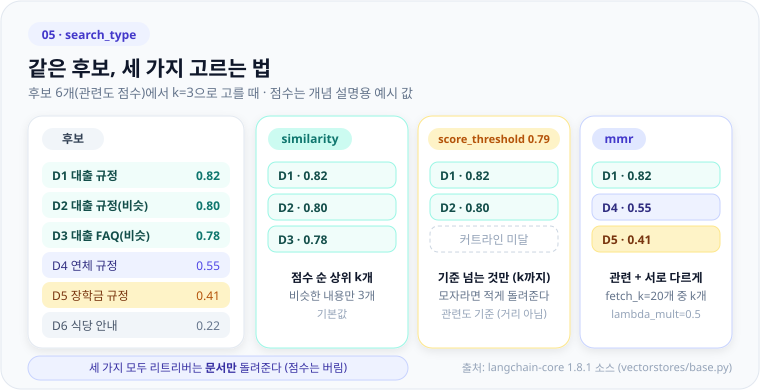
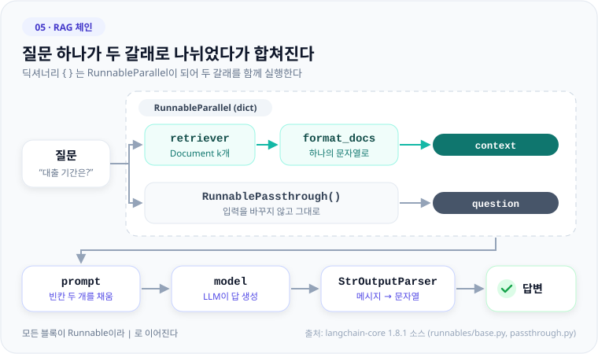
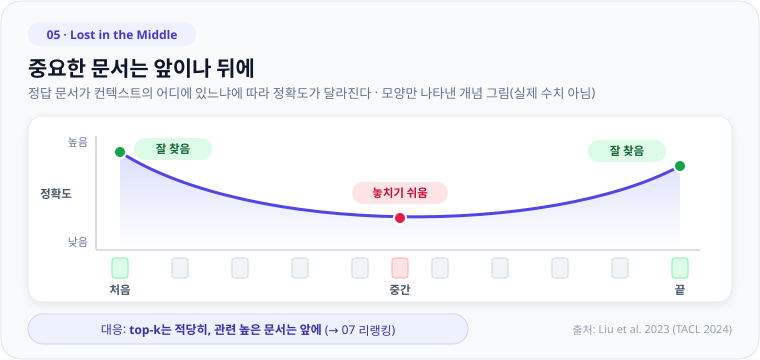

# 05. 리트리버와 RAG 체인

> **지금 위치:** Part 1 기초(01 · 02) → **[Part 2 파이프라인: 03 · 04 · 05]** → Part 3 품질 개선(06 · 07 · 08) → Part 4 평가(09 · 10)
>
> [← 이전: 04 벡터 저장소](04_벡터저장소_PGVector.md) | [지도](00_지도.md) | [다음: 06 BM25와 하이브리드 검색 →](06_BM25와_하이브리드검색.md)

> **검증 완료** (2026-11-19) — ✅ 10 · ⚠️ 0 · ❌ 0 · ❓ 0 · 기준: 설치된 소스(langchain-core 1.8.1)·원 논문 · [검증 보고서 보기](검증/03_05_검증보고서.md#05-리트리버와-rag-체인)
> 이 세션은 모든 항목이 출처와 일치했습니다. 아래 ✅ 표시는 복습에 도움이 되는 추가 사실입니다.

## 핵심 질문

**검색과 생성을 하나의 흐름으로 어떻게 이을까?**

## 한 줄 요약

LangChain의 부품은 모두 **Runnable** 이라는 표준을 따라서 `.invoke()`로 실행하고 `|`로 연결한다. 벡터 저장소를 **리트리버**로 감싸면 체인에 바로 끼울 수 있고, `검색 → 문서 이어 붙이기 → 프롬프트 → 모델 → 파서` 가 하나의 RAG 체인이 된다.

---

## 왜 필요한가 (04의 한계)

- `vector_store.similarity_search(...)`는 **Runnable이 아니어서** `|`로 체인에 바로 넣을 수 없다.
- 저장소를 PGVector에서 다른 것으로 바꾸면 검색 코드도 바꿔야 한다.

## 1. Runnable — LangChain 부품의 표준 규격

> 출처: [26-11-17.md](../26-11-17.md)

- `.invoke()`가 있고 `|`로 연결할 수 있는 것은 모두 Runnable이다.
- **리트리버, 프롬프트, 모델, 파서** 가 모두 Runnable이다.
- `|` 한쪽이 Runnable이면 자동으로 감싸 준다:
  - 일반 함수 → `RunnableLambda`
  - 딕셔너리 → `RunnableParallel`
- ✅ 검증 05-1, 05-2: `coerce_to_runnable`이 함수는 `RunnableLambda`, dict는 `RunnableParallel`로 감싼다(`runnables/base.py` 6643–6646행). `BaseRetriever`는 `RunnableSerializable`을 상속해서 체인에 바로 들어간다(`retrievers.py` 55행).

```python
chain = model | StrOutputParser()           # chapter01/src/test.ipynb
chain.invoke(("user", "오늘 날짜는?"))
```

## 2. 리트리버 (Retriever)

**"질문을 넣으면 Document 리스트를 돌려주는 표준 규격의 검색기"**

| 저장소에서 직접 찾기 | 리트리버로 찾기 |
|---|---|
| `vector_store.similarity_search(질문)` | `retriever.invoke(질문)` |
| 체인에 바로 못 넣음 | 체인에 바로 넣을 수 있음 (Runnable) |
| 점수를 볼 수 있음 (`..._with_score`) | 점수는 안 나옴 |
| 저장소마다 다를 수 있음 | PGVector든 BM25든 웹 검색이든 **똑같이 `.invoke()`** |

→ **점수를 보고 싶으면 저장소에서 직접**, **체인에 넣을 땐 리트리버**.

- ✅ 검증 05-6: 리트리버는 `similarity_score_threshold` 모드에서도 내부에서 받은 점수를 **버리고 문서만** 돌려준다. (`vectorstores/base.py` 1048–1059행)

### 리트리버 설정

> 출처: [26-11-17.md](../26-11-17.md) (교안에 정리 안 된 부분), `chapter03/03_01.ipynb`

```python
retriever = vector_store.as_retriever(
    search_type="similarity",       # "similarity"(기본) / "similarity_score_threshold" / "mmr"
    search_kwargs={
        "k": 3,                                  # 가져올 문서 수 (기본 4)
        "filter": {"year": {"$gte": 2025}},      # 메타데이터 조건 (→ 04)
        # "score_threshold": 0.3,                # search_type="similarity_score_threshold" 일 때만 동작
    },
)
```

### 점수 커트라인 걸기

```python
SCORE_THRESHOLD = 0.7   # 허용할 최대 코사인 거리

# 저장소에서 직접 (관련도 점수 0~1, 클수록 비슷)
vector_store.similarity_search_with_relevance_scores(query=query, score_threshold=1 - SCORE_THRESHOLD)
# → 관련도 >= 0.3 (= 거리 <= 0.7) 인 문서만

# 리트리버로
vector_store.as_retriever(
    search_type="similarity_score_threshold",
    search_kwargs={"score_threshold": 1 - SCORE_THRESHOLD},
)
```

- `score_threshold`는 **거리가 아니라 관련도** 기준이다. 그래서 `1 − 거리` 로 바꿔서 넣는다 (→ 02 §4).



> ✅ **검증 05-3 ~ 05-5, 05-7**
> - 허용되는 `search_type`은 정확히 `similarity` / `similarity_score_threshold` / `mmr` 세 가지이고, `k` 기본값은 4입니다. (`vectorstores/base.py` 363·977–981행)
> - `score_threshold`는 `similarity_score_threshold`일 때만 꺼내 씁니다. (348·528행)
> - 이전의 Claude 보충(MMR)도 소스와 같습니다. MMR은 "질문과의 유사도와 **고른 문서들 사이의 다양성**을 함께 최적화"합니다. 먼저 `fetch_k=20`개를 가져와서 그중 `k`개를 고르고, `lambda_mult=0.5`로 관련도와 다양성의 비중을 정합니다. (660–670행)

> `[보충 · ✅ 검증 05-7]` `search_type="mmr"` (Maximal Marginal Relevance)는 관련도가 높으면서도 **서로 내용이 겹치지 않는** 문서를 고르는 방식입니다. 비슷한 청크 여러 개가 상위를 차지하는 걸 막아 줍니다.

### 내 실습 메모 (03_01)
- `retriever.invoke()` 결과는 내가 넣은 `initial_documents`를 그대로 돌려주는 게 아니라, **DB 안의 모든 문서와 질문 사이 거리를 계산해서 새로 만든 리스트**다.
- 도서관·장학금 문서가 둘 다 나온 건 문서가 2개뿐이고 k를 안 정해서(기본 4) 둘 다 들어간 것일 뿐이다.
- `for doc in searched_docs: print(doc)` 는 출력용일 뿐, 순위 계산은 `invoke()`에서 이미 끝났다.

## 3. RAG 체인 조립

> 출처: `chapter03/03_01.ipynb`, `chapter01/src/02.ipynb`

```python
from langchain_core.prompts import ChatPromptTemplate
from langchain_core.output_parsers import StrOutputParser
from langchain_core.runnables import RunnablePassthrough

def format_docs(docs):
    # Document 리스트 → 하나의 문자열
    return "\n\n".join(doc.page_content for doc in docs)

prompt = ChatPromptTemplate.from_messages([
    ("system", """당신은 대학 학사 규정 안내 전문가입니다.
제공된 [참고 문서]에만 근거해서 답변하고, 문서에 없는 내용은 '죄송하지만 알지 못합니다.'라고 답변하세요.

[참고 문서]
{context}"""),
    ("user", "{question}"),
])

chain = (
    {"context": retriever | format_docs, "question": RunnablePassthrough()}
    | prompt
    | model
    | StrOutputParser()
)
chain.invoke("도서관 대출 권수와 기간 규정을 알려줘.")
```

흐름:



- ✅ 검증 05-9: `RunnablePassthrough`는 입력을 바꾸지 않고 넘기는, 항등 함수에 가까운 Runnable이다. (`runnables/passthrough.py` 74–77행)

- 딕셔너리 `{...}` 는 자동으로 `RunnableParallel`이 되어 두 갈래를 동시에 실행한다.
- 프롬프트의 **"문서에 있는 내용만, 없으면 모른다고"** 지시가 환각을 줄이는 첫 번째 장치다 (→ 09 신뢰도).

> `[보충 · ✅ 검증 05-10]` 실습 노트북 `03_01.ipynb`의 `format_docs`는 `for doc in searched_docs`로 되어 있어서, 매개변수 `docs`가 아니라 **앞 셀의 전역 변수**를 쓰고 있습니다. 그래서 체인에 어떤 질문을 넣어도 앞 셀에서 검색한 문서가 들어갑니다. `for doc in docs`로 고쳐야 체인이 매번 새로 검색한 문서를 씁니다.

## 4. Lost in the Middle

> 출처: [26-11-17.md](../26-11-17.md), [26-11-18.md](../26-11-18.md)

- 프롬프트가 길면 LLM이 **앞쪽과 뒤쪽만 잘 보고 중간을 놓치는** 현상.


- 그래서:
  - 문서를 너무 많이 넣지 않는다 (**top-k를 적당히**).
  - **관련도가 높은 문서를 앞쪽**에 둔다. (→ 07 리랭킹의 이유)

> ✅ **검증 05-8** — 원 논문(Liu et al. 2023, TACL 2024)은 관련 정보가 컨텍스트의 **처음이나 끝**에 있을 때 성능이 가장 높고, **중간**에 있을 때 크게 떨어지는 **U자 곡선**을 보고했습니다. 다만 모델·과제에 따라 덜 나타난다는 후속 연구도 있어서, "항상 그렇다"기보다 "그럴 수 있으니 대비한다"로 기억하면 됩니다.
> 출처: [Liu et al. 2023, Lost in the Middle](https://arxiv.org/abs/2307.03172)

---

## 이 방식의 한계 → 다음 세션

기본 RAG 파이프라인이 완성됐다. 그런데 실제로 써 보면 **검색이 엉뚱하게 나올 때**가 있다. 특히 "VPN", 상품 코드, 고유명사처럼 **정확한 키워드**가 중요한 질문에서 의미 검색은 약하다.
→ [06. BM25와 하이브리드 검색](06_BM25와_하이브리드검색.md)

---

## 스스로 점검

1. Runnable이란? 리트리버·프롬프트·모델·파서의 공통점은?
2. `similarity_search`와 `retriever.invoke`는 언제 각각 쓰나?
3. `as_retriever`에서 `score_threshold`가 동작하려면 무엇을 같이 설정해야 하나?
4. RAG 체인에서 `RunnablePassthrough()`의 역할은?
5. Lost in the Middle을 줄이는 방법 두 가지는?

<details>
<summary>답 보기</summary>

1. `.invoke()`로 실행하고 `|`로 연결할 수 있는 LangChain 표준 규격. 넷 다 Runnable이다.
2. 점수를 보고 싶을 땐 저장소에서 직접, 체인에 넣을 땐 리트리버.
3. `search_type="similarity_score_threshold"`
4. 입력된 질문을 그대로 `{question}` 자리로 넘긴다.
5. top-k를 적당히 줄인다 / 관련 높은 문서를 앞쪽에 둔다.

</details>

## 원본 노트

- [26-11-17.md](../26-11-17.md) — Runnable, 리트리버, as_retriever 설정, 관련도 점수, Lost in the Middle
- `chapter03/03_01.ipynb` — 리트리버, 점수 커트라인, RAG 체인
- `chapter01/src/02.ipynb`, `test.ipynb` — 첫 RAG 체인, 기본 체인
