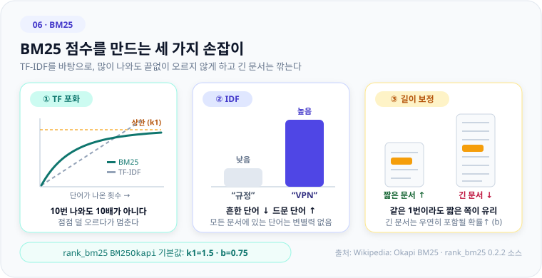
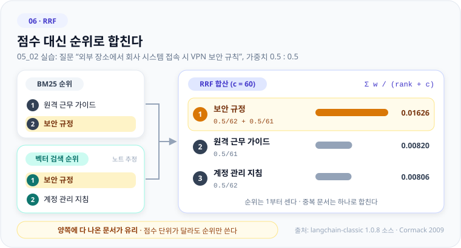

# 06. BM25와 하이브리드 검색

> **지금 위치:** Part 1 기초(01 · 02) → Part 2 파이프라인(03 · 04 · 05) → **[Part 3 품질 개선: 06 · 07 · 08]** → Part 4 평가(09 · 10)
>
> [← 이전: 05 리트리버와 RAG 체인](05_리트리버와_RAG체인.md) | [지도](00_지도.md) | [다음: 07 리랭킹과 압축 →](07_리랭킹과_압축.md)

> **Part 3에서 개선하는 세 가지:** **[06 찾는 방법]** → 07 찾은 결과 → 08 질문 자체

> **검증 완료** (2026-11-19) — ✅ 13 · ⚠️ 0 · ❌ 0 · ❓ 2 · 기준: 설치된 소스(langchain-community 0.4.2, langchain-classic 1.0.8, rank_bm25 0.2.2)·Elastic 문서·원 논문 · [검증 보고서 보기](검증/06_08_검증보고서.md#06-bm25와-하이브리드-검색)
> 본문의 ❓ 표시는 "신뢰할 출처에서 확인하지 못했다"는 뜻입니다. 원래 노트 내용은 그대로 두었습니다.

## 핵심 질문

**의미 검색이 정확한 키워드를 놓치면 어떻게 할까?**

## 한 줄 요약

키워드 검색 알고리즘 **BM25**(TF-IDF의 개선판)와 의미(벡터) 검색을 **EnsembleRetriever**로 섞는 것이 **하이브리드 검색**이다. 두 점수는 단위가 달라서 그냥 더하지 않고, 순위만 쓰는 **RRF**로 합친다.

---

## 왜 필요한가 (05의 한계)

- 벡터 검색은 **"뜻"** 으로 찾는다. 대부분 좋지만, 상품명·코드·고유명사처럼 **정확한 단어가 일치해야 하는** 질문에는 약하다.
- 반대로 키워드 검색은 단어가 달라도 뜻이 같은 문서("재택"과 "원격")를 놓친다.
- 둘은 잘하는 게 다르다 → **섞어 쓴다**.

| | 의미 검색 | 키워드 검색 |
|---|---|---|
| 다른 이름 | 시맨틱 검색, **dense** | 어휘 검색, **sparse** |
| 기준 | 임베딩 벡터의 거리 | 단어 일치 |
| 강점 | 표현이 달라도 뜻이 같으면 찾음 | 정확한 키워드, 고유명사 |
| 대표 | pgvector + 코사인 | BM25 |

## 1. TF-IDF → BM25

> 출처: [26-11-17.md](../26-11-17.md)

### TF-IDF (BM25의 전신)
- **TF (Term Frequency, 단어 빈도)**: 문서 안에 그 단어가 자주 나올수록 중요하다고 본다.
- **IDF (Inverse Document Frequency, 역문서 빈도)**: 여러 문서에 흔한 단어("the", "is")는 점수를 낮추고, 몇몇 문서에만 나오는 희귀한 단어는 높인다. (전체 문서 수 ÷ 그 단어가 든 문서 수, 에 로그)

### BM25 (Best Matching 25)
- **Okapi** 검색 시스템(1980년대~)에서 나왔고, BM25 공식은 1994년쯤 나왔다. "Okapi"는 API가 아니라 **검색 시스템 이름**, 25는 **25번째 버전**.
- Elasticsearch 같은 전통 검색 엔진뿐 아니라 요즘 **RAG의 어휘 검색, LLM 에이전트의 툴 검색**에서도 핵심이다.

> ✅ **검증 06-2, 06-3** — "BM = best matching", "Okapi는 처음 이 함수를 쓴 검색 시스템(런던 City University, 1980~90년대)", "BM25는 TF-IDF와 비슷한 계열의 함수"는 Wikipedia와 같습니다.
> ❓ **검증 06-4** — "25 = 25번째 버전", "1994년쯤"은 확인하지 못했습니다.
> 출처: [Wikipedia: Okapi BM25](https://en.wikipedia.org/wiki/Okapi_BM25)

BM25가 TF-IDF를 개선한 세 가지:

| 요소 | 내용 |
|---|---|
| ① TF **포화** | 단어가 많이 나올수록 점수가 오르지만 **상한**이 있다. 10번 나와도 10배가 되지 않는다. |
| ② IDF | 흔한 단어는 점수↓, 드문 단어는 점수↑ |
| ③ **문서 길이 보정** | 긴 문서는 단어가 우연히 들어 있을 확률이 높아서 점수를 조금 깎는다. |



> ✅ **검증 06-5, 06-6** — 공식에서 `k1`이 TF 포화, `b`가 문서 길이 보정을 맡습니다. 실습에서 쓰는 rank_bm25 `BM25Okapi`의 기본값은 `k1=1.5`, `b=0.75`이고, `BM25Retriever`가 내부에서 이 클래스를 만들어 내 컴퓨터에서 계산합니다. (`rank_bm25.py` 78–79행, `retrievers/bm25.py` 55·64행)

### BM25의 3층 구조

| 층 | BM25 쪽 | 벡터 쪽 대응 |
|---|---|---|
| 수학 공식 | BM25 공식 | 코사인 공식 |
| 계산하는 도구 | `BM25Okapi` (rank_bm25 라이브러리, 내 컴퓨터에서 계산, API 호출 없음) | pgvector `<=>` |
| LangChain 리트리버 | `BM25Retriever` (`.invoke()` → Document 리스트) | `as_retriever()` |

## 2. 코드로 보기 — BM25Retriever

> 출처: `chapter05/05_01.ipynb`

```python
from langchain_community.retrievers import BM25Retriever

def custom_tokenizer(text):
    return text.split()          # 띄어쓰기로 자르기 (LangChain 기본값과 같음)

bm25_retriever = BM25Retriever.from_documents(documents=raw_documents, preprocess_func=custom_tokenizer)
bm25_retriever.k = 2             # 가져올 개수 (기본 4). from_documents(..., k=2)로 넣어도 같다

bm25_retriever.invoke("재택 근무 VPN 접속")
```

### 내 실습 결과 분석
- "재택 근무 VPN 접속" → 원격 근무 문서만 **2.0296점**(재택, 근무 일치), 나머지는 **0점**.
- 그런데도 계정 관리 문서가 2등으로 들어왔다. **BM25Retriever는 커트라인이 없어서** k=2를 채우려고 0점 문서도 넣는다.
- 띄어쓰기로만 자르면 **"VPN"과 "VPN을", "접속"과 "접속해야"를 다른 단어**로 본다. → 한국어는 조사가 붙어서 키워드 일치가 잘 안 된다.
- `custom_tokenizer` 자리는 **한국어 형태소 분석기** 같은 다른 토크나이저를 끼울 수 있다는 걸 보여 주는 자리다.

> ✅ **검증 06-7 ~ 06-9** — 기본 토크나이저는 `text.split()`, `k` 기본값은 4입니다. 0점 문서도 들어오는 이유는 rank_bm25의 `get_top_n`이 점수를 **정렬해서 위에서 n개를 자를 뿐**, 점수로 거르는 코드가 없기 때문입니다.
> 출처: `langchain_community/retrievers/bm25.py` 11–22·115행, `rank_bm25.py` 69–75행

> `[확인 필요]` 26-11-18 노트의 "어휘 불일치를 막기 위해 설치하는 분석기"는 한국어 **형태소 분석기**(예: Kiwi, Okt 등)를 말한 것으로 보입니다. 수업에서 언급한 이름을 확인하세요.

## 3. 하이브리드 검색 — EnsembleRetriever

> 출처: `chapter05/05_02.ipynb`, [26-11-17.md](../26-11-17.md)

```python
from langchain_classic.retrievers import EnsembleRetriever

vector_retriever = PGVector.from_documents(...).as_retriever(search_kwargs={"k": 2})

hybrid_retriever = EnsembleRetriever(
    retrievers=[bm25_retriever, vector_retriever],
    weights=[0.5, 0.5],     # 키워드 : 의미 비율
)
hybrid_retriever.invoke("외부 장소에서 회사 시스템 접속 시 VPN 보안 규칙")
```

- **EnsembleRetriever에는 자기 k가 없다.** 각 리트리버가 k개씩 가져오고, 겹치는 문서를 합쳐서 돌려준다. (실습: 2 + 2개 → 중복 1개 → 3개)
- **가중치를 누가 정하나?** 사람이 직접 정하거나(예: `[0.5, 0.5]`), LLM이 질문이 키워드형인지 의미형인지 판단해서 정하게 할 수도 있다.

> ✅ **검증 06-11** — `EnsembleRetriever`는 각 리트리버 결과를 RRF로 합친 뒤 `unique_by_key`로 중복을 지웁니다. `weights`를 안 주면 균등하게 나눕니다. (`langchain_classic/retrievers/ensemble.py` 36·87·340행)
> ❓ **검증 06-14** — "LLM이 판단해서 가중치를 정한다"는 직접 설계할 수는 있지만, 공식 기능이나 권장 방식으로는 확인하지 못했습니다. `EnsembleRetriever`의 가중치는 고정값으로 넣습니다.

## 4. RRF (Reciprocal Rank Fusion, 역순위 융합)

**문제**: BM25 점수(예: 2.03)와 코사인 점수(0~1)는 **단위가 다르다**. 가중치를 곱해서 그냥 더하면 단위가 큰 쪽이 순위를 좌우한다.

**해결**: 점수 대신 **순위**라는 같은 기준으로 바꾼다.

```
RRF 점수 = Σ  가중치 × 1 / (순위 + c)        c는 보통 60
```

- 키워드 쪽, 의미 쪽 각각 계산해서 더한 값으로 최종 순위를 다시 매긴다.
- **양쪽에 다 나온 문서가 유리**하다.

실습(05_02) 예시 (가중치 0.5 / 0.5):

| 문서 | 계산 | RRF 점수 | 순위 |
|---|---|---|---|
| 보안 규정 | 0.5/61 + 0.5/62 (양쪽 다 나옴) | ≈ 0.01626 | 1 |
| 원격 근무 | 0.5/61 | ≈ 0.0082 | 2 |
| 계정 관리 | 0.5/62 | ≈ 0.00806 | 3 |

> 노트 메모: 의미 검색 쪽 순위는 최종 결과를 보고 추정한 값입니다(직접 출력해서 확인한 값은 아님).



> ✅ **검증 06-10, 06-12** — 설치된 소스의 계산식이 노트와 같습니다: `weight / (rank + self.c)`, 순위는 **1부터** 세고, `c` 기본값은 **60**입니다. 그래서 1등은 `0.5/61`, 2등은 `0.5/62`가 됩니다. RRF는 Cormack 등(SIGIR 2009)이 제안한 방법이고, Elasticsearch도 같은 공식(1/(k+순위) 합)으로 하이브리드 결과를 합칩니다.
> 출처: `langchain_classic/retrievers/ensemble.py` 70·328–335행, [Cormack et al. 2009](https://plg.uwaterloo.ca/~gvcormac/cormacksigir09-rrf.pdf), [Elastic Docs: RRF](https://www.elastic.co/docs/reference/elasticsearch/rest-apis/reciprocal-rank-fusion)

### 헷갈림 주의: k가 두 개
- **top-k의 k** (예: 2) = 몇 개 가져올지
- **RRF의 k** (예: 60) = 점수 공식 안에 더하는 상수
- 글자만 같고 하는 일이 달라서, LangChain은 RRF 쪽 상수를 **`c`** 라고 부른다.

## 5. 검색 방식 vs 저장 위치는 별개

> 출처: [26-11-17.md](../26-11-17.md) "복습하면서 추가 정리"

"**어떻게 찾나**"(BM25/벡터)와 "**어디에 두나**"(메모리/디스크)는 다른 축이다.

| 도구 | 검색 방식 | 저장 위치 | 비고 |
|---|---|---|---|
| `BM25Retriever` | 키워드 | 메모리 | 커널 재시작하면 사라짐. 다시 만드는 비용이 거의 없어 연습용으로 좋음 |
| `InMemoryVectorStore` | 벡터 | 메모리 | |
| `PGVector` | 벡터 | DB 디스크 | 임베딩 API 비용 때문에 저장해 둠 |
| **Elasticsearch** | 키워드 + 벡터 | 디스크 | 하이브리드 검색을 한 곳에서. 튜터님은 이쪽을 더 많이 쓰심 |

- ✅ 검증 06-1, 06-13: Elasticsearch는 BM25가 기본 점수 방식이고, kNN 벡터 검색 결과와 RRF로 합치는 하이브리드 검색을 공식 지원한다. ([Elastic Docs: Ranking](https://www.elastic.co/docs/solutions/search/ranking))

## 6. LangChain 패키지 정리

| 패키지 | 실습에서 쓴 것 |
|---|---|
| `langchain_core` | Document, 프롬프트, 파서, BaseRetriever |
| `langchain_openai` | OpenAIEmbeddings |
| `langchain_postgres` | PGVector |
| `langchain_community` | BM25Retriever, 문서 로더, HuggingFaceCrossEncoder |
| `langchain_classic` | EnsembleRetriever, ContextualCompressionRetriever, CacheBackedEmbeddings, index |

- rank_bm25, PostgreSQL+pgvector, OpenAI 서버는 LangChain이 아니라, LangChain 클래스가 안에서 불러 쓰는 **도구**다.
- ✅ 검증 06-15: 설치된 패키지 경로가 위 표와 같다(`langchain_community/retrievers/bm25.py`, `langchain_classic/retrievers/ensemble.py`).

---

## 이 방식의 한계 → 다음 세션

하이브리드로 후보를 더 잘 모았다. 그런데 **가져온 문서들의 순서**는 여전히 대략적이고, 문서 안에 질문과 상관없는 내용도 섞여 있다. Lost in the Middle을 생각하면 **가장 관련 있는 걸 정확히 맨 앞에** 두고 싶다.
→ [07. 리랭킹과 압축](07_리랭킹과_압축.md)

---

## 스스로 점검

1. 의미 검색과 키워드 검색은 각각 무엇에 강한가?
2. BM25가 TF-IDF보다 나아진 세 가지는?
3. BM25Retriever로 검색했더니 0점 문서가 결과에 들어왔다. 왜?
4. BM25 점수와 코사인 점수를 가중치 곱해서 그냥 더하면 안 되는 이유는?
5. RRF에서 양쪽 검색에 모두 나온 문서가 유리한 이유는?
6. EnsembleRetriever의 결과 개수는 어떻게 정해지나?

<details>
<summary>답 보기</summary>

1. 의미 검색은 표현이 달라도 뜻이 같은 문서, 키워드 검색은 정확한 단어·고유명사.
2. TF 포화(상한), IDF, 문서 길이 보정.
3. BM25Retriever는 점수 커트라인이 없어서 k개를 채우려고 0점 문서도 넣는다.
4. 점수 단위가 달라서 단위가 큰 쪽이 순위를 좌우한다.
5. 각 검색에서 받은 1/(순위+c) 점수가 더해지기 때문이다.
6. 자기 k가 없다. 각 리트리버의 k개를 합치고 중복을 제거한 수다.

</details>

## 원본 노트

- [26-11-12.md](../26-11-12.md) — §3 키워드 기반 검색, 하이브리드
- [26-11-17.md](../26-11-17.md) — BM25, TF-IDF, RRF, Hybrid Search, 복습 추가 정리(1, 3, 4, 5)
- [26-11-18.md](../26-11-18.md) — 마지막 줄 top-k의 k vs RRF의 k
- `chapter05/05_01.ipynb` — BM25Retriever
- `chapter05/05_02.ipynb` — EnsembleRetriever
