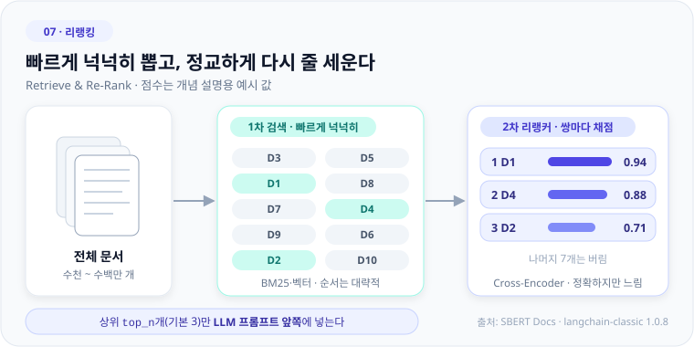
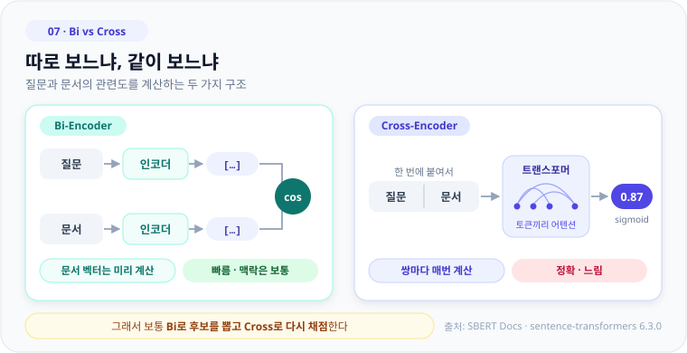

# 07. 리랭킹과 압축

> **지금 위치:** Part 1 기초(01 · 02) → Part 2 파이프라인(03 · 04 · 05) → **[Part 3 품질 개선: 06 · 07 · 08]** → Part 4 평가(09 · 10)
>
> [← 이전: 06 BM25와 하이브리드 검색](06_BM25와_하이브리드검색.md) | [지도](00_지도.md) | [다음: 08 쿼리 변환 →](08_쿼리변환.md)

> **Part 3에서 개선하는 세 가지:** 06 찾는 방법 → **[07 찾은 결과]** → 08 질문 자체

> **검증 완료** (2026-11-19) — ✅ 10 · ⚠️ 1 · ❌ 0 · ❓ 0 · 기준: 설치된 소스(langchain-classic 1.0.8, sentence-transformers 6.3.0)·SBERT 공식 문서·Hugging Face 모델 카드 · [검증 보고서 보기](검증/06_08_검증보고서.md#07-리랭킹과-압축)
> 본문의 ⚠️ 표시는 "공식 문서는 이렇게 말한다"는 뜻입니다. 원래 노트 내용은 그대로 두었습니다.

## 핵심 질문

**찾아온 문서들의 순서가 별로이거나, 쓸데없는 내용이 섞여 있으면?**

## 한 줄 요약

**1차로 넉넉히 뽑고, 2차로 정교하게 다시 순위를 매기는** 2단계 검색 구조가 리랭킹이다. 빠른 **Bi-Encoder**와 정확한 **Cross-Encoder** 중 상황에 맞게 고른다. 문서에서 필요한 부분만 남기는 **압축**도 같은 틀(ContextualCompressionRetriever)로 한다.

---

## 왜 필요한가 (06의 한계)

- 1차 검색(벡터/BM25/하이브리드)은 **빠르지만 대략적**이다.
- **Lost in the Middle**: LLM은 앞과 뒤만 잘 본다. 컨텍스트를 많이 넣는다고 좋은 게 아니라, **관련 있는 게 위에 있어야** 정답을 잘 말한다. → 그래서 리랭킹을 쓴다. (✅ 검증 07-10, [05 세션 검증](05_리트리버와_RAG체인.md#4-lost-in-the-middle) 참고)

## 1. 리랭킹 (Re-ranking, 재순위)

> 출처: [26-11-18.md](../26-11-18.md), [26-11-12.md](../26-11-12.md) §4



> ✅ **검증 07-1, 07-11** — Sentence-Transformers 공식 문서의 "Retrieve & Re-Rank" 구조와 같습니다. 빠른 Bi-Encoder로 후보(예: 상위 100개)를 뽑고, 느리지만 정확한 Cross-Encoder로 다시 순위를 매깁니다. Cross-Encoder는 정밀도가 높지만 큰 데이터 전체에 쓰기엔 확장되지 않습니다.
> 출처: [SBERT: Retrieve & Re-Rank](https://sbert.net/examples/sentence_transformer/applications/retrieve_rerank/README.html)

| 장점 | 단점 |
|---|---|
| 신뢰도·정밀도가 높아진다 | 문서(청크)마다 다 비교해야 해서 **연산이 많다 → 시간과 비용** |
| | 모델 운영(LLMOps)이 필요하다 |

## 2. Bi-Encoder vs Cross-Encoder



| | Bi-Encoder | Cross-Encoder |
|---|---|---|
| 방식 | 질문과 문서를 **따로** 임베딩 → 코사인 유사도 | 질문과 문서를 **붙여서 함께** 인코더에 넣고, "잘 어울린다"를 0~1로 분류 |
| 속도 | **빠름**. 문서 임베딩을 미리 계산·**캐싱 가능** | **느림**. 질문이 올 때마다 쌍마다 계산 |
| 맥락 파악 | 아주 높지는 않음 | 토큰끼리 서로 보면서 판단 → **높음** |
| 언제 | 속도가 중요할 때 | 정확도가 중요할 때 |

- 정답은 없다. 트레이드오프를 비교해서 고른다. 교안은 Cross-Encoder를 쓴다.
- 둘 다 싫으면 LLM에게 점수를 매기게 할 수도 있지만, 보통 Cross-Encoder가 LLM보다 빠르다.
- 실습 모델: Hugging Face **`Dongjin-kr/ko-reranker`** (한국어·영어 지원 경량 Cross-Encoder, 0~1 점수)

> ✅ **검증 07-2 ~ 07-4** — SBERT 공식 문서와 같습니다. Bi-Encoder는 문장마다 따로 임베딩하므로 문서를 **미리 인코딩**해 둘 수 있고, Cross-Encoder는 쌍을 함께 넣어 질문과 문서 사이에 **어텐션**을 계산합니다. 점수가 0~1로 나오는 이유: 출력이 1개인 모델이면 sentence-transformers가 `predict` 때 **기본으로 sigmoid**를 씌우기 때문입니다.
> 출처: [SBERT: Cross-Encoders](https://sbert.net/examples/cross_encoder/applications/README.html), `sentence_transformers/cross_encoder/model.py` 130–131행

> ⚠️ **검증 07-5 · ko-reranker는 "경량"?** — 모델 카드 기준으로 **BAAI/bge-reranker-large를 한국어 데이터로 파인튜닝**한 약 **0.56B(5.6억) 파라미터** 모델입니다. Hub에는 한국어·영어로 표시되어 있지만, "경량"이라는 표현은 모델 카드에 없습니다. 실습 노트북 주석의 표현입니다.
> 출처: [Hugging Face: Dongjin-kr/ko-reranker](https://huggingface.co/Dongjin-kr/ko-reranker)

### `[내 질문]` Cross-Encoder는 LLM 안에 있는 거 아니었나? 왜 LLM을 대신 써도 된다고 하셨지?

> `[보충 · ✅ 검증 07-9]` 둘 다 트랜스포머 기반이라 헷갈리기 쉽습니다. (LangChain에도 LLM으로 순위를 다시 매기는 `LLMListwiseRerank`가 따로 있습니다 — `document_compressors/listwise_rerank.py`)
> - **Cross-Encoder**는 "질문-문서가 관련 있나?" **한 가지 일만 하도록 학습된 작은 전용 모델**입니다. 출력은 점수 하나뿐이라 빠릅니다.
> - **LLM**도 프롬프트로 "이 문서가 질문과 관련 있으면 0~10점을 매겨" 라고 시키면 같은 일을 할 수 있습니다. 더 똑똑하지만 크고 느리고 비쌉니다.
> - 그래서 "Cross-Encoder 대신 LLM을 써도 된다" = **같은 역할(재채점)을 범용 LLM에게 시킬 수도 있다**는 뜻입니다. Cross-Encoder가 LLM 안에 들어 있는 건 아닙니다.
> - 파인튜닝과의 관계: Cross-Encoder 리랭커는 "관련도 판정"에 맞게 **학습(파인튜닝)된 모델**이고, RAG 파이프라인에서는 그 모델을 가져다 **쓰기만** 합니다.

### 코드로 보기

> 출처: `chapter05/05_04.ipynb`

```python
from langchain_community.cross_encoders import HuggingFaceCrossEncoder
from langchain_classic.retrievers.document_compressors import CrossEncoderReranker
from langchain_classic.retrievers import ContextualCompressionRetriever

cross_encoder_model = HuggingFaceCrossEncoder(model_name="Dongjin-kr/ko-reranker")
reranker = CrossEncoderReranker(model=cross_encoder_model, top_n=2)   # 다시 매겨서 상위 2개만

rerank_retriever = ContextualCompressionRetriever(
    base_compressor=reranker,        # 2차: 다시 순위 매기기
    base_retriever=bm25_retriever,   # 1차: 넉넉히 가져오기
)
rerank_retriever.invoke("사내 웹 메일의 비밀번호 여러 번 틀렸을 때 처리 방법")
```

- 리랭킹은 하이브리드 검색과 **다른** 고도화 기법이다. 하이브리드는 "후보를 어떻게 모으나", 리랭킹은 "모은 후보를 어떻게 다시 줄 세우나".
- ✅ 검증 07-6, 07-7: `CrossEncoderReranker`의 `top_n` 기본값은 **3**이다(실습은 2로 바꿈). `ContextualCompressionRetriever`는 `base_retriever`로 가져온 뒤 `base_compressor`로 줄인다. (`cross_encoder_rerank.py` 22행, `contextual_compression.py` 16–40행)

## 3. 문맥 압축 (Contextual Compression)

> 출처: `chapter05/05_05.ipynb`

**문제**: 한 청크 안에 여러 주제가 섞여 있으면, 관련 없는 문장까지 LLM에 들어가서 노이즈가 된다.

**해결**: LLM이 각 문서에서 **질문과 관련된 문장만 뽑아** 남긴다.

```python
from langchain_classic.retrievers.document_compressors import LLMChainExtractor

compressor = LLMChainExtractor.from_llm(model)
compression_retriever = ContextualCompressionRetriever(
    base_compressor=compressor,
    base_retriever=base_retriever,
)
compression_retriever.invoke("사내 복지 포인트 남으면 다음 해로 넘겨서 쓸 수 있나요?")
# → 복지 문서에서 "미사용 잔여 포인트는 12월 31일에 소멸되어 이월되지 않습니다" 부분만 남는다
```

> ✅ **검증 07-8** — `LLMChainExtractor`는 문서에서 관련 부분만 뽑고, 관련 내용이 하나도 없으면 LLM이 `NO_OUTPUT`을 내서 그 문서는 **결과에서 아예 빠집니다**. 그래서 압축 뒤 문서 개수가 줄어들 수 있습니다.
> 출처: `langchain_classic/retrievers/document_compressors/chain_extract.py` 28–42·85–86행

### 같은 틀, 다른 부품
`ContextualCompressionRetriever` = **기본 검색기 + 후처리기(compressor)**

| compressor | 하는 일 |
|---|---|
| `CrossEncoderReranker` | 순위를 다시 매기고 상위 n개만 남김 |
| `LLMChainExtractor` | 문서 안에서 관련 문장만 추출 |

---

## 이 방식의 한계 → 다음 세션

찾는 방법(06)과 찾은 결과(07)를 개선했다. 그런데 **질문 자체가 애매하거나**("그거 어떻게 해요?"), 사용자 표현과 문서 표현이 너무 다르면("배가 콕콕 쑤실 때 먹는 약" vs "소화제") 처음부터 검색이 빗나간다.
→ [08. 쿼리 변환](08_쿼리변환.md)

---

## 스스로 점검

1. 리랭킹의 2단계 구조를 설명해 보자. 왜 처음부터 Cross-Encoder로 전부 검색하지 않을까?
2. Bi-Encoder와 Cross-Encoder의 차이를 방식·속도·정확도로 비교하면?
3. 리랭킹을 쓰는 이유를 Lost in the Middle과 연결해서 설명해 보자.
4. 하이브리드 검색과 리랭킹은 어떻게 다른가?
5. `ContextualCompressionRetriever`에 넣을 수 있는 compressor 두 가지와 각각의 역할은?

<details>
<summary>답 보기</summary>

1. 1차로 빠른 검색으로 넉넉히 뽑고, 2차로 정교한 모델로 다시 순위를 매긴다. Cross-Encoder는 쌍마다 계산해서 느리므로 전체 문서에 쓰기엔 너무 비싸다.
2. Bi는 따로 임베딩 후 코사인(빠름, 캐싱 가능, 맥락 파악 보통), Cross는 붙여서 함께 인코딩 후 0~1 분류(느림, 정확).
3. LLM은 앞과 뒤만 잘 보므로, 가장 관련 있는 문서를 정확히 앞에 두려고 리랭킹한다.
4. 하이브리드는 후보를 모으는 방법, 리랭킹은 모은 후보를 다시 줄 세우는 방법이다.
5. CrossEncoderReranker(재정렬 후 상위 n개), LLMChainExtractor(관련 문장만 추출).

</details>

## 원본 노트

- [26-11-18.md](../26-11-18.md) — 리랭킹, Bi/Cross-Encoder, Lost in the Middle
- [26-11-12.md](../26-11-12.md) — §4 프롬프트 다듬기 기법 (Reranking)
- `chapter05/05_04.ipynb` — CrossEncoderReranker
- `chapter05/05_05.ipynb` — LLMChainExtractor (문맥 압축)
