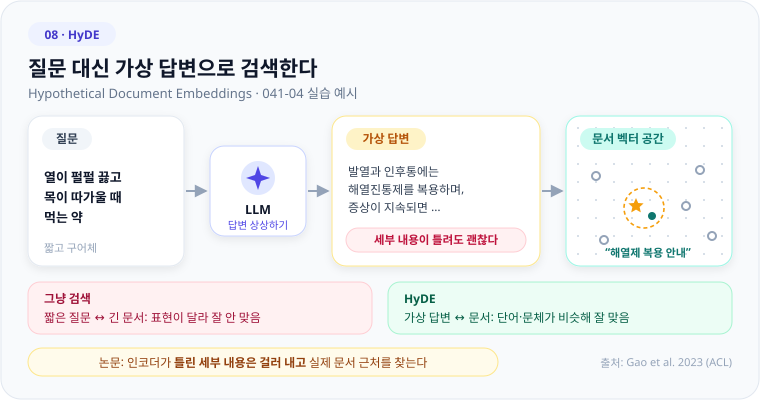
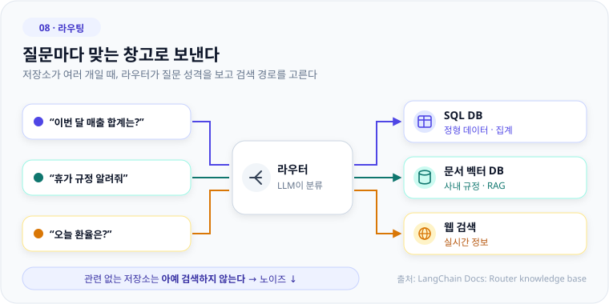
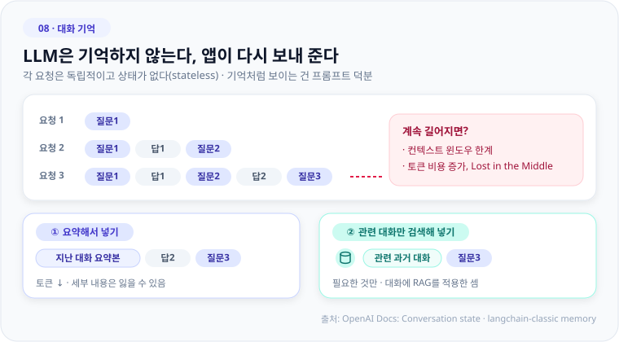

# 08. 쿼리 변환

> **지금 위치:** Part 1 기초(01 · 02) → Part 2 파이프라인(03 · 04 · 05) → **[Part 3 품질 개선: 06 · 07 · 08]** → Part 4 평가(09 · 10)
>
> [← 이전: 07 리랭킹과 압축](07_리랭킹과_압축.md) | [지도](00_지도.md) | [다음: 09 RAG 평가 지표 →](09_RAG평가_지표.md)

> **Part 3에서 개선하는 세 가지:** 06 찾는 방법 → 07 찾은 결과 → **[08 질문 자체]**

> **검증 완료** (2026-11-19) — ✅ 6 · ⚠️ 0 · ❌ 0 · ❓ 2 · 기준: 원 논문(HyDE, Query Rewriting, Step-back)·LangChain·OpenAI 공식 문서 · [검증 보고서 보기](검증/06_08_검증보고서.md#08-쿼리-변환)
> ❓ 두 개는 수업에서 받아쓴 이름이라 외부 출처로 확인할 수 없는 항목입니다.

## 핵심 질문

**사용자 질문 자체가 애매하거나 문서와 표현이 다르면 어떻게 할까?**

## 한 줄 요약

검색하기 전에 LLM으로 **질문을 바꾼다.** 검색에 유리한 문장으로 다시 쓰거나(**Rewrite**), 가상의 답변을 먼저 만들어 그걸로 검색하거나(**HyDE**), 질문 성격에 맞는 저장소로 보낸다(**라우팅**).

---

## 왜 필요한가 (07의 한계)

- 06, 07은 **질문이 괜찮다는 전제**에서 검색을 개선했다.
- 하지만 사용자는 "그거 어떻게 해요?", "열이 펄펄 끓고 목이 따가울 때 먹는 약"처럼 말한다. 문서에는 "해열제", "인후염"이라고 적혀 있다.
- 질문이 빗나가면 아무리 좋은 검색기도 엉뚱한 걸 찾는다. 수업 표현: *"RAG는 검색 품질에 목숨을 걸어야 한다."*

## 1. Query Rewrite (질문 재작성)

> 출처: [26-11-12.md](../26-11-12.md) §4, `chapter05/041-04.ipynb`

사용자 질문이 애매할 때 LLM으로 **검색에 적합한 형태**로 바꾼다.

```python
rewrite_prompt = PromptTemplate.from_template("""
사용자의 질문을 검색 시스템이 문서를 탐색하기 유리하도록 핵심 명사 중심의 명확한 문장으로 다시 작성하세요.

사용자의 질문 : {question}
변환된 질문 :
""")
rewrite_chain = rewrite_prompt | model
```

> ✅ **검증 08-1** — Query Rewriting 논문은 "입력 질문과 필요한 지식 사이에는 차이가 있다"고 보고, 검색 전에 질문을 다시 쓰는 단계를 넣었더니 성능이 꾸준히 좋아졌다고 보고했습니다. LangChain 공식 문서도 "불분명한 질문을 다시 쓰기, 여러 변형 만들기"를 질문 개선 방법으로 듭니다.
> 출처: [Ma et al. 2023, EMNLP](https://arxiv.org/abs/2305.14283), [LangChain Docs: Retrieval](https://docs.langchain.com/oss/python/langchain/retrieval)

## 2. HyDE (Hypothetical Document Embeddings, 가상 문서 임베딩)

> 출처: [26-11-18.md](../26-11-18.md), `chapter05/041-04.ipynb`

**아이디어**: 짧은 질문과 긴 문서는 모양이 달라서 벡터가 잘 안 맞는다. 그러니 LLM에게 **가상의 답변(문서처럼 생긴 글)** 을 먼저 쓰게 하고, **그 가상 답변으로 검색**한다. 답변은 문서와 비슷한 단어·문체를 쓰니까 진짜 문서와 더 가깝게 나온다.



```python
hyde_prompt = PromptTemplate.from_template("""
다음 질문에 대한 객관적인 사실을 서술하는 한 단락의 학술적 답변을 작성하세요.

질문 : {question}
가설 답변 :
""")
hyde_doc = (hyde_prompt | model).invoke({"question": "열이 펄펄 끓고 목이 따가울 때 먹는 약"})
# hyde_doc.content 로 벡터 검색
```

- 가상 답변이 **사실과 달라도 괜찮다.** 목적은 답이 아니라 **검색용 미끼**다.

> ✅ **검증 08-2** — HyDE 원 논문 초록이 그대로 말합니다: 가상 문서는 "관련성 패턴은 담지만 실제가 아니고 **거짓 세부 내용을 포함할 수 있다**". 그 문서를 인코더로 벡터화하면, 인코더의 압축 과정이 **잘못된 세부 내용을 걸러 내고** 실제 문서들이 있는 근처를 찾아 준다는 설명입니다. 참고로 논문은 한국어(ko)를 포함한 여러 언어에서도 실험했습니다.
> 출처: [Gao et al. 2023, ACL](https://arxiv.org/abs/2212.10496)

## 3. 쿼리 라우팅 (Query Routing)

> 출처: [26-11-18.md](../26-11-18.md)

여러 개의 특화 저장소(문서 DB, SQL DB, 웹 검색)가 있을 때, **질문의 성격을 판별해서 알맞은 저장소로 검색 요청을 보내는** 기법.



> ✅ **검증 08-3** — LangChain은 질문을 분류해서 관련 있는 소스로만 보내는 **router 패턴**을 공식 튜토리얼로 제공합니다(예: GitHub·Notion·Slack 중 골라 보내기). 수업에서 말한 "워크플로우에서 배운다"와 연결되는 부분으로, LangGraph로 구현합니다.
> 출처: [LangChain Docs: Build a multi-source knowledge base with routing](https://docs.langchain.com/oss/python/langchain/multi-agent/router-knowledge-base)

- 수업에서 "라우팅은 다음에 **워크플로우**에서 배우면 더 이해가 잘 된다"고 하셨다.
- 06의 "LLM이 질문이 키워드형인지 의미형인지 판단해서 하이브리드 가중치를 정한다"도 비슷한 발상이다.

## 4. "4대 쿼리 변환 기법"

> `[확인 필요]` 26-11-18 노트에 "4대 변환 기법"이라고만 적혀 있고 목록이 끊겼습니다. 노트에서 확인되는 것은 **Rewrite, HyDE, 라우팅** 입니다.
>
> `[보충]` 일반적으로 많이 묶어서 소개하는 쿼리 변환 기법은 다음과 같습니다. 교안의 4가지와 비교해 보세요.
>
> | 기법 | 아이디어 |
> |---|---|
> | Query Rewrite | 질문을 검색에 맞게 다시 쓰기 |
> | HyDE | 가상 답변을 만들어 그걸로 검색 |
> | Multi-Query | 질문을 여러 관점으로 바꿔 각각 검색하고 결과 합치기 |
> | Step-back / 질문 분해 | 더 일반적인 질문으로 물러서거나, 복잡한 질문을 작은 질문으로 쪼개기 |
>
> ✅ **검증 08-4** — 위 보충 중 Multi-Query와 Step-back은 출처로 확인했습니다. Multi-Query는 LangChain `MultiQueryRetriever`(LLM이 여러 질문을 만들어 각각 검색하고 중복 없이 합침), Step-back은 원 논문(더 추상적인 질문으로 원리를 먼저 끌어냄)이 있습니다.
> 출처: [LangChain Reference: MultiQueryRetriever](https://reference.langchain.com/python/langchain-classic/retrievers/multi_query/MultiQueryRetriever), [Zheng et al. 2023, ICLR 2024](https://arxiv.org/abs/2310.06117)
> ❓ **검증 08-5** — 수업의 "4대" 묶음이 무엇인지는 교안에서 정한 것이라 외부 출처로 확인할 수 없습니다.

## 5. (관련 주제) LLM이 대화를 기억하는 방법

> 출처: [26-11-18.md](../26-11-18.md)

- **정답은 프롬프트에 있다.** LLM은 기억하지 않는다. 지난 대화(human / ai / human ...)를 **프롬프트에 다시 넣어 주기 때문에** 기억하는 것처럼 보인다. → 컨텍스트 엔지니어링의 한 부분.
- 대화가 길어지면 컨텍스트 한계 + Lost in the Middle 문제가 생긴다. 그래서 대화 기록을 메모리나 DB에 저장하고 다음 두 가지 방법을 쓴다.

| 방법 | 내용 | 단점 |
|---|---|---|
| ① 대화 **압축(요약)** | 지난 대화를 요약해서 넣는다. 토큰이 준다 | 전체 대화를 다 기억하지는 못한다 |
| ② **벡터 DB로 관련 대화 검색** | 대화를 임베딩해서 저장해 두고, 지금 질문과 비슷한 과거 대화만 꺼내 요약·압축해서 넣는다 | 구현이 복잡하다 |

- ② 는 결국 **RAG를 "지식" 대신 "과거 대화"에 적용**한 것이다. 벡터 DB는 지식 저장소 말고 기억 저장소로도 쓸 수 있다.



> ✅ **검증 08-6, 08-7** — OpenAI 공식 문서: "각 요청은 독립적이고 **상태가 없다(stateless)**. 여러 턴 대화는 이전 메시지를 요청에 함께 넣어서 구현한다." 노트의 "정답은 프롬프트에 있다"와 같습니다. 두 가지 대처 방법도 LangChain에 각각 클래스로 있습니다(요약 메모리 `memory/summary.py`, 벡터 저장소 메모리 `memory/vectorstore.py`).
> 출처: [OpenAI Docs: Conversation state](https://developers.openai.com/api/docs/guides/conversation-state), `langchain_classic/memory/`

> ❓ **검증 08-8** · `[확인 필요]` 노트에 "레그/매그 기법"으로 들렸다고 적혀 있습니다. 위 ② 방식을 RAG 기반 메모리로 설명하신 것으로 보이지만, 정확한 기법 이름은 확인하세요.

---

## 이 방식의 한계 → 다음 세션

Part 3에서 찾는 방법·찾은 결과·질문을 모두 개선해 봤다. 그런데 **정말 좋아졌는지 어떻게 알까?** 청크 크기를 바꾸고, 리랭커를 붙이고, HyDE를 쓰는 게 "느낌상 좋아 보이는" 걸로는 부족하다.
→ [09. RAG 평가 지표](09_RAG평가_지표.md)

---

## 스스로 점검

1. Query Rewrite는 어떤 상황에 쓰나?
2. HyDE에서 LLM이 만든 가상 답변이 틀려도 괜찮은 이유는?
3. 쿼리 라우팅을 예를 들어 설명해 보자.
4. LLM이 이전 대화를 "기억하는" 원리는?
5. 대화가 길어질 때 쓰는 두 가지 방법과 각각의 단점은?

<details>
<summary>답 보기</summary>

1. 사용자 질문이 애매하거나 검색에 불리한 표현일 때.
2. 가상 답변은 정답이 아니라 실제 문서와 비슷한 표현으로 검색하기 위한 미끼이기 때문이다.
3. 질문 성격을 판별해 매출은 SQL DB로, 규정은 문서 DB로, 실시간 정보는 웹 검색으로 보낸다.
4. 지난 대화 기록을 매번 프롬프트에 다시 넣어 준다.
5. 대화 압축(전체를 다 기억 못 함), 벡터 DB로 관련 대화 검색(구현 복잡).

</details>

## 원본 노트

- [26-11-12.md](../26-11-12.md) — §4 Rewrite Query
- [26-11-18.md](../26-11-18.md) — Query 변환 기법, HyDE, 라우팅, 대화 기억
- `chapter05/041-04.ipynb` — Rewrite, HyDE 실습
