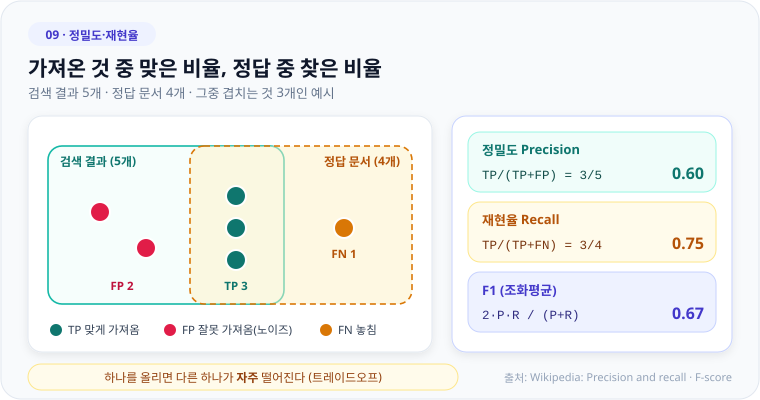
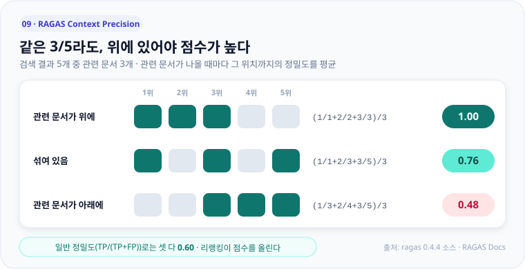
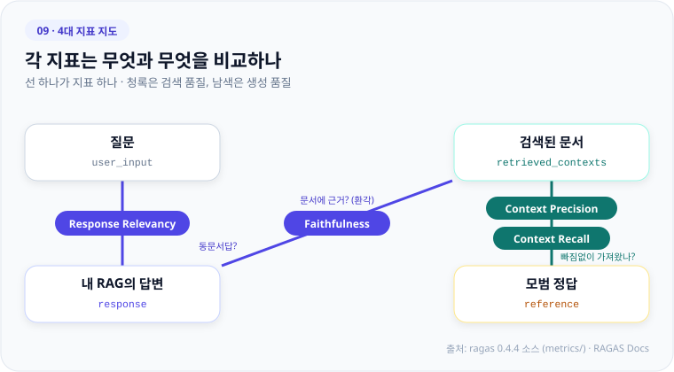

# 09. RAG 평가 지표

> **지금 위치:** Part 1 기초(01 · 02) → Part 2 파이프라인(03 · 04 · 05) → Part 3 품질 개선(06 · 07 · 08) → **[Part 4 평가: 09 · 10]**
>
> [← 이전: 08 쿼리 변환](08_쿼리변환.md) | [지도](00_지도.md) | [다음: 10 골든셋과 RAGAS →](10_RAG평가_골든셋과_RAGAS.md)

> **검증 완료** (2026-11-19) — ✅ 7 · ⚠️ 2 · ❌ 0 · ❓ 2 · 기준: 설치된 소스(ragas 0.4.4)·RAGAS 공식 문서·Wikipedia · [검증 보고서 보기](검증/09_99_검증보고서.md#09-rag-평가-지표)
> 본문의 ⚠️ / ❓ 표시는 "공식 문서는 이렇게 말한다"는 뜻입니다. 원래 노트 내용은 그대로 두었습니다.

## 핵심 질문

**"검색이 좋아졌다", "답변이 좋아졌다"를 숫자로 말하려면?**

## 한 줄 요약

RAG는 **검색 품질**(Context Precision, Context Recall)과 **생성 품질**(Faithfulness, Answer Relevancy)로 나눠 평가한다. 이 넷이 **RAG 4대 지표**다. 정밀도와 재현율은 서로 반비례하는 경향이 있어서 둘의 균형을 F1으로 본다.

---

## 왜 필요한가 (08의 한계)

03 ~ 08에서 청크 크기, top-k, 하이브리드 가중치, 리랭커, 쿼리 변환 등 **조절할 손잡이**가 많이 생겼다. 무엇이 효과가 있었는지 감으로는 알 수 없다. 숫자가 있어야 비교하고 개선할 수 있다.

## 0. 먼저 알아야 할 것: TP / FP / FN

> 출처: [26-11-18.md](../26-11-18.md)

|  | 실제로 관련 있음 | 실제로 관련 없음 |
|---|---|---|
| **관련 있다고 예측 (검색됨)** | **TP** (True Positive) 맞게 찾음 | **FP** (False Positive) 잘못 찾음 = **노이즈** |
| **관련 없다고 예측 (검색 안 됨)** | **FN** (False Negative) 놓침 | (TN) |



- ✅ 검증 09-1: TP·FP·FN과 정밀도·재현율 공식은 정보 검색의 표준 정의와 같다. ([Wikipedia: Precision and recall](https://en.wikipedia.org/wiki/Precision_and_recall))

## 1. 검색 품질 지표

### Context Precision (문맥 정밀도) — "가져온 것 중 진짜 맞는 건 몇 %?"

```
정밀도 = TP / (TP + FP)
```
- 예: 검색된 문서 5개 중 정답에 기여한 문서 3개 → **3/5 = 0.6**
- **FP를 줄여야 할 때** 중요하다. 예: 스팸 분류기가 일반 메일을 스팸으로 잘못 보내면 안 될 때.
- 낮으면 → 노이즈가 많다. top-k 줄이기, 리랭킹, 메타데이터 필터.

> ⚠️ **검증 09-2 · RAGAS의 Context Precision은 순서를 본다** — 위 공식은 일반적인 정밀도 정의로는 맞습니다. 하지만 실습에서 쓰는 **RAGAS의 Context Precision은 다르게 계산**합니다. "관련 청크를 관련 없는 청크보다 **위에 두는 능력**"을 재는 지표라서, 관련 청크가 나올 때마다 그 위치까지의 정밀도(precision@k)를 구해 평균을 냅니다.
>
> 그래서 노트 예시처럼 **5개 중 3개가 관련 있어도**, 그 3개가 어디 있느냐에 따라 점수가 달라집니다.
>
> | 관련 문서 위치 | 계산 | 점수 |
> |---|---|---|
> | 1·2·3위 | (1/1 + 2/2 + 3/3) / 3 | **1.00** |
> | 1·3·5위 | (1/1 + 2/3 + 3/5) / 3 | **0.76** |
> | 3·4·5위 | (1/3 + 2/4 + 3/5) / 3 | **0.48** |
>
> 이 지표가 리랭킹(07)의 효과를 잘 보여 주는 이유이기도 합니다. 관련 문서를 위로 올리면 점수가 오릅니다.
> 출처: `ragas/metrics/_context_precision.py` 113–132행, [RAGAS Docs: Context Precision](https://docs.ragas.io/en/stable/concepts/metrics/available_metrics/context_precision/)



### Context Recall (문맥 재현율) — "있어야 할 것 중 몇 %를 빠뜨리지 않고 찾았나?"

```
재현율 = TP / (TP + FN) = 찾아낸 정답 문서 수 / 전체 정답 문서 수
```
- 예: 정답에 필요한 문서가 5개인데 검색 결과에 그중 3개만 들어 있었다 → **3/5 = 0.6**
- **FN을 줄여야 할 때** 중요하다. 예: 암 진단, 금융 사기 탐지처럼 놓치면 큰일 날 때.
- 근거 문서의 내용이 정답에 다 반영되어 있어야 재현율이 높다.
- 낮으면 → 필요한 문서를 못 찾고 있다. top-k 늘리기, 청킹 조정, 하이브리드 검색.

> `[보충 · ✅ 검증 09-3]` 노트의 재현율 예시가 받아쓰다 끊겨 있어서 위처럼 정리했습니다. RAGAS의 Context Recall은 **모범 정답의 문장들이 검색된 문서로 뒷받침되는지를 문장 단위로** 확인합니다. (노트: "라가스는 문장 단위로 한다") 설치된 소스도 문장마다 1/0으로 분류해서 `뒷받침된 문장 수 / 전체 문장 수`로 계산합니다. (`ragas/metrics/_context_recall.py` 49·114–117행)

### 정밀도와 재현율의 트레이드오프

| 이렇게 하면 | 결과 |
|---|---|
| 정말 확실한 것만 "관련 있음" | 정밀도 ↑, 그런데 진짜 관련 문서를 놓쳐서(FN↑) 재현율 ↓ |
| 조금이라도 관련 있어 보이면 다 "관련 있음" | 재현율 ↑, 그런데 엉뚱한 문서가 섞여서(FP↑) 정밀도 ↓ |

→ 재현율을 높이면 노이즈가 커지니 정밀도는 당연히 떨어진다.

- ✅ 검증 09-4: Wikipedia도 "**자주(often)** 반비례 관계가 있어 하나를 올리면 다른 하나가 떨어진다"고 설명한다. 항상은 아니고 경향이다. 예시로 화재경보기를 드는데, 불을 놓치면 큰일이라 오경보(FP)를 감수하고 재현율을 택한다. ([Wikipedia](https://en.wikipedia.org/wiki/Precision_and_recall))

### F1 Score — 둘의 균형

```
F1 = 2 × (정밀도 × 재현율) / (정밀도 + 재현율)      ← 조화평균
```
- **조화평균**은 한쪽이 너무 낮으면 전체 값이 확 낮아진다. 그래서 둘 다 괜찮아야 F1이 높다.
- ✅ 검증 09-5: F1은 정밀도와 재현율의 조화평균이다. ([Wikipedia: F-score](https://en.wikipedia.org/wiki/F-score))

## 2. 생성 품질 지표

### Faithfulness (신뢰도, 사실성) — "답변이 문서에 근거했나?" = 환각 판별

> 출처: [26-11-18.md](../26-11-18.md), [26-11-19.md](../26-11-19.md)

- 답변과 컨텍스트를 비교한다. 답변을 여러 개의 **개념(주장) 문장**으로 쪼개고, 각 문장이 컨텍스트에서 확인되는지 본다.
- 낮다 = 문서 기반이 아니라 **모델이 원래 갖고 있던 파라미터 지식으로 답했다** = 환각.

**개선 방법 (순서대로)**
1. **프롬프트 개선**: 출처를 명확히 하고, `{context}`에서만 근거를 찾게 하고, **없으면 모른다고 답하게** 한다.
2. 프롬프트를 고쳐도 안 나아지면 → **LLM 품질 문제** → 모델 교체.

> ✅ **검증 09-6** — RAGAS Faithfulness는 답변에서 뽑은 **주장(statement)** 하나하나가 컨텍스트로 뒷받침되는지 판정하고 `근거 있는 주장 수 / 전체 주장 수`로 계산합니다. (`ragas/metrics/_faithfulness.py` 182–192행)
> ❓ **검증 09-7** — "프롬프트 개선 → 모델 교체" 순서는 수업에서 배운 대처 요령이고, 공식 문서에서 이 순서를 찾지는 못했습니다.

### Answer Relevancy (답변 관련성) — "동문서답하지 않았나?"

- **역질문**을 한다: 답변을 보고 "이 답변은 어떤 질문에 대한 답일까?"를 만들어, 원래 질문과 비슷한지 비교한다.
- 비교 방법:
  - 임베딩 거리로 → Bi-Encoder 방식
  - 정밀하게 → Cross-Encoder 같은 트랜스포머 계열 (→ 07)
- 낮다 = **노이즈** 문제. 컨텍스트 청킹이나 top-k를 수정해 본다.

> ✅ **검증 09-8** — RAGAS는 LLM이 답변에서 질문을 기본 **3개** 만들고(`strictness=3`), 원래 질문과의 **코사인 유사도 평균**을 점수로 씁니다. 답변이 "모르겠어요"처럼 **회피하는 답(noncommittal)** 이면 0점입니다.
> ⚠️ **검증 09-9 · Cross-Encoder로 잰다?** — RAGAS의 이 지표는 **임베딩 코사인만** 씁니다. Cross-Encoder로 재는 방식은 RAGAS 기본 지표에 없고, 직접 만들어 쓸 수 있는 별도 아이디어입니다.
> ❓ **검증 09-10** — "낮으면 청킹·top-k 수정"은 수업의 대처 요령입니다. RAGAS 문서는 이 지표가 사실 정확도가 아니라 **질문 의도와의 일치**를 보며, **불완전하거나 군더더기가 많은 답**을 감점한다고 설명합니다.
> 출처: `ragas/metrics/_answer_relevance.py` 38·64·94·114–127행, [RAGAS Docs: Response Relevancy](https://docs.ragas.io/en/stable/concepts/metrics/available_metrics/answer_relevance/)

## 3. 4대 지표 한눈에

| 구분 | 지표 | 묻는 것 | 낮을 때 의심할 것 |
|---|---|---|---|
| 검색 | Context Precision | 가져온 것 중 쓸모 있는 비율 | 노이즈, top-k 과다 |
| 검색 | Context Recall | 필요한 것을 다 가져왔나 | 청킹, 검색 방식, top-k 부족 |
| 생성 | Faithfulness | 답이 문서에 근거했나 (환각) | 프롬프트, LLM 모델 |
| 생성 | Answer Relevancy | 질문에 맞게 답했나 | 노이즈, 청킹, top-k |

- 이 지표들을 손으로 계산하지 않고 **RAGAS**가 LLM을 써서 자동으로 계산해 준다. → 10



- ✅ 검증 09-11: 네 지표 모두 설치된 RAGAS에 클래스로 있다(`ContextPrecision`, `ContextRecall`, `Faithfulness`, `ResponseRelevancy`). 최신 이름은 Answer Relevancy가 아니라 **Response Relevancy**다.

---

## 이 방식의 한계 → 다음 세션

지표는 알았다. 그런데 계산하려면 **"정답"** 이 있어야 한다. 무엇이 정답 문서이고 모범 답안인지는 어떻게 준비할까? 그리고 실제로 어떻게 돌릴까?
→ [10. 골든셋과 RAGAS](10_RAG평가_골든셋과_RAGAS.md)

---

## 스스로 점검

1. TP, FP, FN을 RAG 검색 상황으로 설명해 보자.
2. 검색 결과 4개 중 정답 기여 문서가 1개다. Context Precision은?
3. 정답에 필요한 문서 4개 중 2개만 검색됐다. Context Recall은?
4. 정밀도와 재현율이 반비례하는 경향이 있는 이유는?
5. F1에 산술평균이 아니라 조화평균을 쓰는 이유는?
6. Faithfulness가 낮을 때 개선 순서는?
7. Answer Relevancy는 어떻게 측정하나?

<details>
<summary>답 보기</summary>

1. TP: 관련 문서를 맞게 가져옴 / FP: 관련 없는 문서를 가져옴(노이즈) / FN: 관련 문서를 놓침
2. 1/4 = 0.25 (일반 정밀도 기준. RAGAS Context Precision이면 그 1개가 몇 위에 있느냐에 따라 달라진다. 1위면 1.0, 4위면 0.25 — 검증 09-2)
3. 2/4 = 0.5
4. 확실한 것만 고르면 놓치는 게 늘고(재현율↓), 넓게 고르면 노이즈가 늘기(정밀도↓) 때문이다.
5. 한쪽이 너무 낮으면 전체가 확 낮아지게 해서, 둘 다 괜찮아야 높은 점수가 나오게 하려고.
6. 프롬프트 개선(컨텍스트만 근거, 없으면 모른다고) → 그래도 안 되면 LLM 모델 교체.
7. 답변에서 역질문을 만들어 원래 질문과 얼마나 비슷한지 측정한다. RAGAS는 역질문 3개와의 **임베딩 코사인 평균**을 쓴다(Cross-Encoder는 RAGAS 기본 방식이 아님 — 검증 09-9).

</details>

## 원본 노트

- [26-11-18.md](../26-11-18.md) — TP/FP/FN, 4대 지표, F1, 신뢰도 개선 방안
- [26-11-19.md](../26-11-19.md) — 생성 품질 지표 보충, 트레이드오프
