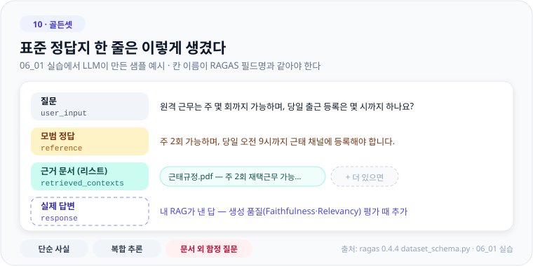
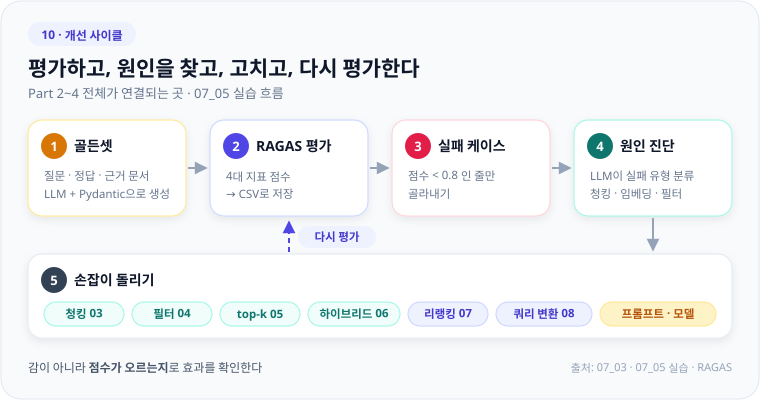

# 10. RAG 평가 — 골든셋과 RAGAS

> **지금 위치:** Part 1 기초(01 · 02) → Part 2 파이프라인(03 · 04 · 05) → Part 3 품질 개선(06 · 07 · 08) → **[Part 4 평가: 09 · 10]**
>
> [← 이전: 09 RAG 평가 지표](09_RAG평가_지표.md) | [지도](00_지도.md) | [헷갈리는 개념 모음 →](99_헷갈리는_개념_모음.md)

> **검증 완료** (2026-11-19) — ✅ 9 · ⚠️ 2 · ❌ 0 · ❓ 1 · 기준: 설치된 소스(ragas 0.4.4)·RAGAS·LangChain·OpenAI 공식 문서 · [검증 보고서 보기](검증/09_99_검증보고서.md#10-골든셋과-ragas)
> 본문의 ⚠️ / ❓ 표시는 "공식 문서는 이렇게 말한다"는 뜻입니다. 원래 노트 내용은 그대로 두었습니다.

## 핵심 질문

**평가에 쓸 "정답지"는 어떻게 만들고, 평가는 실제로 어떻게 돌릴까?**

## 한 줄 요약

**질문 · 모범 정답 · 근거 문서** 세 가지로 된 표준 정답지(**골든셋**)를 만들고(LLM + Pydantic으로 생성 가능), **RAGAS**로 4대 지표를 자동 계산한 뒤, 점수가 낮은 케이스를 골라 **실패 원인을 분석**해서 개선한다.

---

## 왜 필요한가 (09의 한계)

09의 지표는 "정답 문서가 무엇인지", "모범 답안이 무엇인지"를 알아야 계산할 수 있다. 그 기준이 되는 데이터가 필요하다.
수업 강조: **"프로젝트 평가에서 가장 중요한 항목이 데이터 평가셋이다."**

## 1. 골든셋 (Golden Set, 표준 정답지)

> 출처: [26-11-19.md](../26-11-19.md) (6장 1강)

| 구성 요소 | RAGAS 필드명 | 설명 |
|---|---|---|
| 질문 (Question) | `user_input` | 사용자가 할 법한 질문 |
| 모범 정답 (Ground Truth) | `reference` | 근거 문서에 기반한 정답 |
| 근거 문서 (Context) | `retrieved_contexts` | 정답을 이끌어 내는 원본 문서 (리스트) |
| (+ 생성 평가 시) 답변 | `response` | 내 RAG가 실제로 만든 답변 |

- RAGAS로 테스트할 때도 이 세 가지가 필요하다.
- 필드 이름을 RAGAS 데이터셋 항목 이름에 맞춰 지어야 그대로 넣을 수 있다.



- ✅ 검증 10-1: 설치된 RAGAS `SingleTurnSample`의 필드 이름이 `user_input`, `retrieved_contexts`, `reference`, `response`로 정확히 같다. (`ragas/dataset_schema.py` 60–75행)

### 좋은 골든셋 설계 원칙: 질문 유형을 섞는다

| 유형 | 목적 |
|---|---|
| 단순 사실 확인 | 문서 1개로 바로 답할 수 있는 질문 |
| 복합 추론 | 여러 문서를 근거로 논리적 추론이 필요한 질문 |
| **문서 외 함정 질문** | 문서에 없는 근거가 필요한 질문 → **"모른다"고 답하는지(환각 확인)** |

- 일부러 **문제가 되는 질문**도 만들 수 있어야 한다.

> ✅ **검증 10-2** — RAGAS의 테스트셋 생성 기능도 질문을 **single-hop**(문서 1개로 답함)과 **multi-hop**(문서 2개 이상, 여러 단계 추론)으로 나눕니다. 노트의 "단순 사실 확인 / 복합 추론"과 같은 구분입니다. 여기에 구체적(specific) / 추상적(abstract) 축도 있습니다.
> ❓ **검증 10-3** — "문서 외 함정 질문"은 좋은 실무 방법이지만 RAGAS 공식 질문 유형에는 없습니다.
> 출처: [RAGAS Docs: Testset Generation](https://docs.ragas.io/en/stable/concepts/test_data_generation/rag/)

## 2. 코드로 보기 — LLM으로 골든셋 만들기

> 출처: `chapter06_07/06_01.ipynb`

```python
from typing import List
from pydantic import BaseModel, Field

class RagEvalSample(BaseModel):
    user_input: str = Field(description="근거 문서들을 바탕으로 사용자가 질의할 법한 질문")
    reference: str = Field(description="근거 문서에 기반한 모범정답(Ground Truth)")
    retrieved_contexts: List[str] = Field(description="질문과 정답을 도출하는 데 실제로 사용된 1개 이상의 원본 문서 내용")

class RagEvalDataset(BaseModel):
    samples: List[RagEvalSample] = Field(description="근거 문서로부터 생성된 평가 샘플 목록")

structured_model = model.with_structured_output(RagEvalDataset)   # 응답을 이 형태로 강제

chain = prompt | structured_model
result = chain.invoke({"context": format_documents(source_docs), "num_samples": 4})
# → RagEvalDataset(samples=[RagEvalSample(user_input='원격 근무는 주 몇 회까지 ...', ...), ...])
```

- **왜 Pydantic인가?** `StrOutputParser`는 문자열만 준다. JSON으로 달라고 해도 항목 이름이 달라지거나 형식이 깨질 수 있다. Pydantic 스키마로 **타입과 필드를 강제**하면 그런 문제가 줄어든다. (그래서 타입을 꼭 지정한다.)
- `Field(description=...)` 의 설명이 LLM에게 "이 칸에 무엇을 넣어라"는 지시가 된다.
- ✅ 검증 10-4: LangChain 공식 문서 — Pydantic 모델을 주면 **자동으로 검증된 객체**가 돌아온다. 파싱이 실패한 이유를 보고 싶으면 `include_raw=True`를 준다. ([LangChain Docs: Models](https://docs.langchain.com/oss/python/langchain/models))

> `[보충 · ✅ 검증 10-5]` 실습 노트북 `06_01.ipynb`의 필드 이름이 `retrived_contesxts`(오타)로 되어 있습니다. RAGAS는 `retrieved_contexts`라는 이름을 기대하므로, 이 결과를 RAGAS에 바로 넣으려면 철자를 맞춰야 합니다.

## 3. RAGAS로 평가하기

> 출처: [26-11-19.md](../26-11-19.md) (7장 3강), `chapter06_07/07_03.ipynb`, `07_04.ipynb`

- **EvaluationDataset**: 모델·LLM·AI 에이전트의 성능을 객관적으로 측정하고 **회귀 테스트**(고친 뒤 다른 곳이 나빠지지 않았나)를 하기 위한 테스트 샘플 모음.
- 평가 결과를 **pandas DataFrame**으로 바꿔서 보고, CSV로 저장해 둔다. (`uv add pandas`)

```python
import pandas as pd
from ragas import EvaluationDataset, evaluate
from ragas.llms import LangchainLLMWrapper
from ragas.metrics import ContextPrecision, ContextRecall

ragas_dataset = EvaluationDataset.from_pandas(pd.DataFrame(eval_raw_data))

evaluator_llm = LangchainLLMWrapper(model, bypass_temperature=True)   # 채점할 LLM

evaluation_result = evaluate(
    dataset=ragas_dataset,
    metrics=[ContextPrecision(llm=evaluator_llm), ContextRecall(llm=evaluator_llm)],
    raise_exceptions=True,
)
df_result = evaluation_result.to_pandas()
df_result.to_csv("search_eval_report.csv", index=False, encoding="utf-8-sig")   # 엑셀에서 한글 안 깨지게
```

생성 품질 평가 (07_04): 답변(`response`)이 데이터에 있어야 하고, Answer Relevancy는 역질문 비교에 **임베딩**도 필요하다.

```python
from ragas.metrics import Faithfulness, ResponseRelevancy
from ragas.embeddings import LangchainEmbeddingsWrapper

metrics = [
    Faithfulness(llm=evaluator_llm),
    ResponseRelevancy(llm=evaluator_llm, embeddings=LangchainEmbeddingsWrapper(embedding_model)),
]
```

| 지표 (09) | RAGAS 클래스 | 필요한 것 |
|---|---|---|
| Context Precision | `ContextPrecision` | LLM |
| Context Recall | `ContextRecall` | LLM |
| Faithfulness | `Faithfulness` | LLM |
| Answer Relevancy | `ResponseRelevancy` | LLM + 임베딩 |

- 평가 LLM은 지표마다 따로 정할 수 있다. **여러 모델로 평가해 보는 것도 좋다** (Ollama로 로컬 모델 평가도 가능).
- `LangchainLLMWrapper`, `LangchainEmbeddingsWrapper`는 LangChain 모델을 RAGAS가 쓸 수 있게 감싸는 어댑터다.

> ✅ **검증 10-6, 10-7** — `EvaluationDataset.from_pandas`가 있고(`dataset_schema.py` 251행), `ResponseRelevancy`는 LLM과 임베딩을 **둘 다** 받는 지표입니다(`_answer_relevance.py` 64행).
> ⚠️ **검증 10-9 · `LangchainLLMWrapper`는 곧 없어진다** — 실습대로 동작은 하지만, 설치된 ragas 0.4.4는 "deprecated, 다음 버전에서 제거"라는 경고를 내고 **`llm_factory`를 쓰라고** 안내합니다. 다음에 RAGAS 버전을 올리면 이 코드가 깨질 수 있습니다.
> 출처: `ragas/llms/base.py` 170행

> `[보충 · ✅ 검증 10-8]` `07_04.ipynb`는 `from ragas.metrics import _faithfulness`로 가져온 뒤 `Faithfulness(...)`를 쓰고 있어서 이름이 맞지 않습니다. 위처럼 `Faithfulness`로 가져와야 합니다. 마지막 `failed_cases` 셀도 조건이 비어 있어(`df_result['']`) 아직 미완성입니다.

### 실습 환경 문제 메모
- **vertexai 더미 모듈**: 설치된 라이브러리 버전에서 `langchain_community`의 vertexai 모듈이 제거되어 RAGAS import 시 오류가 나서, 노트북 맨 위에서 **가짜 모듈을 메모리에 등록**해 우회했다.

> ⚠️ **검증 10-12 · 지금도 필요할까?** — 현재 `chapter06_07/.venv`에 설치된 ragas 0.4.4는 vertexai import를 **try/except로 감싸고**, 없으면 `None`으로 둡니다. 그래서 지금 버전 기준으로는 더미 등록이 **필요 없어 보입니다**. 실습 당시에는 다른 버전이었을 수 있고, 노트북을 다시 실행해 확인하지는 않았습니다.
> 출처: `ragas/llms/base.py` 24–36행
- `[내 질문]` **luna 모델 + temperature 충돌, `bypass_temperature=True`를 넣으니 됨. 왜?**

> `[보충 · ✅ 검증 10-10]` 설치된 RAGAS 소스 주석에도 "일부 LLM(예: o1 계열)은 temperature를 지원하지 않는다"고 적혀 있고, 이 옵션이 꺼져 있으면 RAGAS가 temperature를 0.01(또는 0.3)로 바꿔서 호출합니다(`ragas/llms/base.py` 83–85·184·303행). OpenAI 문서도 최신 추론 모델은 reasoning effort가 none이 아니면 temperature를 빼라고 합니다([OpenAI Docs](https://developers.openai.com/api/docs/guides/latest-model)). 추론(reasoning) 계열 모델 중에는 `temperature` 값을 바꾸는 것을 지원하지 않는 모델이 있습니다. RAGAS는 채점할 때 내부적으로 temperature를 바꿔서 호출하는데, 그 값이 모델에 그대로 전달되면 오류가 납니다. `bypass_temperature=True`는 **RAGAS가 temperature를 덮어쓰지 않게** 하는 옵션이라 오류가 사라진 것으로 보입니다. 옛날 모델은 temperature를 받아 주니 문제가 없었던 것이고요.
>
> `[내 질문 · ✅ 검증 10-11]` **`reasoning_effort`는 temperature랑 다른 건가?** → 다릅니다. (reasoning effort 값은 none ~ max 단계가 있고 모델마다 지원 값이 다릅니다.) `temperature`는 다음 토큰을 고를 때의 **무작위성**(01 참고)이고, `reasoning_effort`는 추론 모델이 답하기 전에 **얼마나 오래·깊이 생각할지**(none / low / ...)입니다.

## 4. 실패 케이스 분석 — 평가 → 원인 → 개선

> 출처: `chapter06_07/07_05.ipynb`, `07_03.ipynb`

실습 데이터에는 **일부러 결함을 넣은** 케이스가 있다:

| 케이스 | 결함 | 원인 | 해결 방향 |
|---|---|---|---|
| 2024년 장학금 마감일 질문 | 2023년 문서가 검색됨 | **메타데이터 필터 미흡** | `year` 필터 (→ 04) |
| 도서관 주말 운영·대출 | 문장이 중간에 잘려 대출 규정 누락 | **청킹 실패** | 청크 크기·overlap 조정 (→ 03) |
| 기숙사 조식 시간 | 정상 | — | — |

```python
SCORE_THRESHOLD = 0.8
failed_cases = df_result[
    (df_result["context_precision"] < SCORE_THRESHOLD) | (df_result["context_recall"] < SCORE_THRESHOLD)
].copy()

# LLM에게 실패 원인 진단 시키기
prompt = PromptTemplate.from_template("""
당신은 RAG 검색 품질 문제를 진단하는 전문가입니다.
아래의 질문, 모범 정답, 실제 검색된 문서를 대조하여 검색 실패 원인을 분석하세요.
[질문] : {question}
[모범 정답] : {reference}
[검색된 문서] {contexts}

1. 실패 유형 : [청킹 실패 / 임베딩 실패 / 메타데이터 필터링 / 기타 실패 중 택 1]
2. 상세 원인 : [2줄 이내]
3. 품질 개선안 : [2줄 이내]
""")
chain = prompt | model | StrOutputParser()
failed_cases["report"] = [chain.invoke({...}) for _, row in failed_cases.iterrows()]
failed_cases.to_csv("search_failure_report.csv", index=False, encoding="utf-8-sig")
```

- 결과 파일: `chapter06_07/search_eval_report.csv`, `search_failure_report.csv`

### RAG 개선 사이클 (Part 2 ~ 4 전체가 연결되는 곳)



- **어떻게 해결해야 하는지에 대한 인사이트를 수시로 가지는 것**이 중요하다.
- 평가셋 자체가 적합한지도 평가한다.

> `[확인 필요]` 노트: "평가셋이 적합한지 평가할 때 뭘 활용하라 하셨는데 뭔지 모르겠음" — 수업에서 말한 도구를 확인하세요.

---

## 이 방식의 한계 → 다음 단계

이제 RAG를 **만들고 → 개선하고 → 평가하는** 한 바퀴를 다 돌았다. 다음은 이것을 실제 서비스(API)로 만드는 단계다. (`rag-enterprise-api/` 진행 시 이어서 정리)
→ 헷갈리는 용어는 [99. 헷갈리는 개념 모음](99_헷갈리는_개념_모음.md)

---

## 스스로 점검

1. 골든셋의 세 가지 구성 요소와 RAGAS 필드명은?
2. 골든셋에 "문서 외 함정 질문"을 넣는 이유는?
3. 골든셋을 LLM으로 만들 때 `StrOutputParser` 대신 Pydantic 구조화 출력을 쓰는 이유는?
4. Faithfulness와 ResponseRelevancy를 평가하려면 데이터와 도구에 각각 무엇이 더 필요한가?
5. "2024년 질문에 2023년 문서가 검색됨" — 어떤 실패 유형이고 어떻게 고치나?
6. `temperature`와 `reasoning_effort`의 차이는?

<details>
<summary>답 보기</summary>

1. 질문(`user_input`), 모범 정답(`reference`), 근거 문서(`retrieved_contexts`)
2. 문서에 없는 걸 물었을 때 "모른다"고 하는지, 즉 환각을 일으키는지 확인하려고.
3. 필드 이름과 타입을 강제해서 JSON 형식이 깨지거나 항목 이름이 달라지는 문제를 막으려고.
4. 데이터에 실제 답변(`response`)이 필요하고, ResponseRelevancy에는 임베딩 모델도 필요하다.
5. 메타데이터 필터링 실패. `year` 메타데이터로 필터를 건다.
6. temperature는 토큰 선택의 무작위성, reasoning_effort는 추론 모델이 생각하는 깊이.

</details>

## 원본 노트

- [26-11-19.md](../26-11-19.md) — 골든셋, RAGAS, EvaluationDataset
- [26-11-18.md](../26-11-18.md) — "RAGAS라는 걸로 하면 알아서 평가"
- `chapter06_07/06_01.ipynb` — Pydantic으로 골든셋 생성
- `chapter06_07/07_03.ipynb` — ContextPrecision, ContextRecall
- `chapter06_07/07_04.ipynb` — Faithfulness, ResponseRelevancy
- `chapter06_07/07_05.ipynb` — 실패 케이스 분석 리포트
